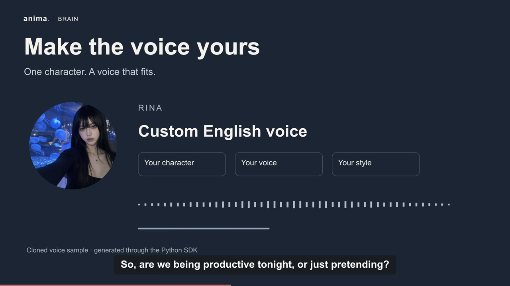
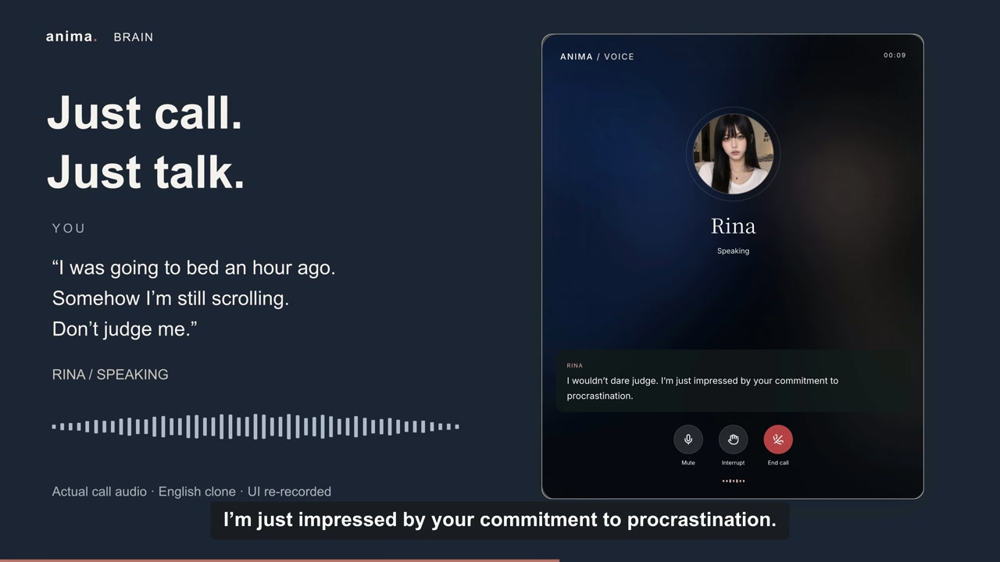
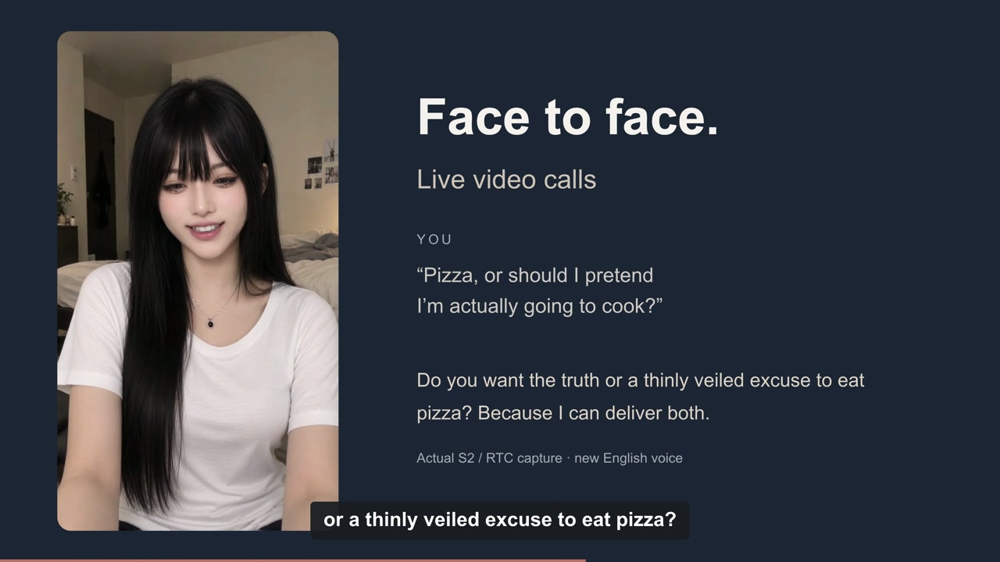
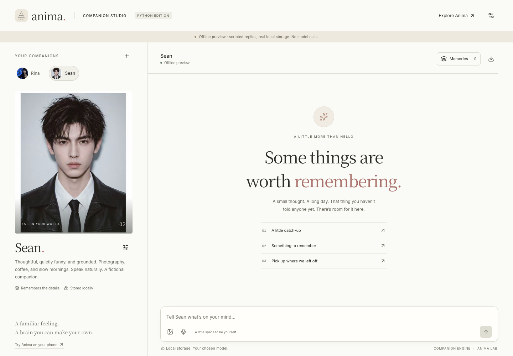
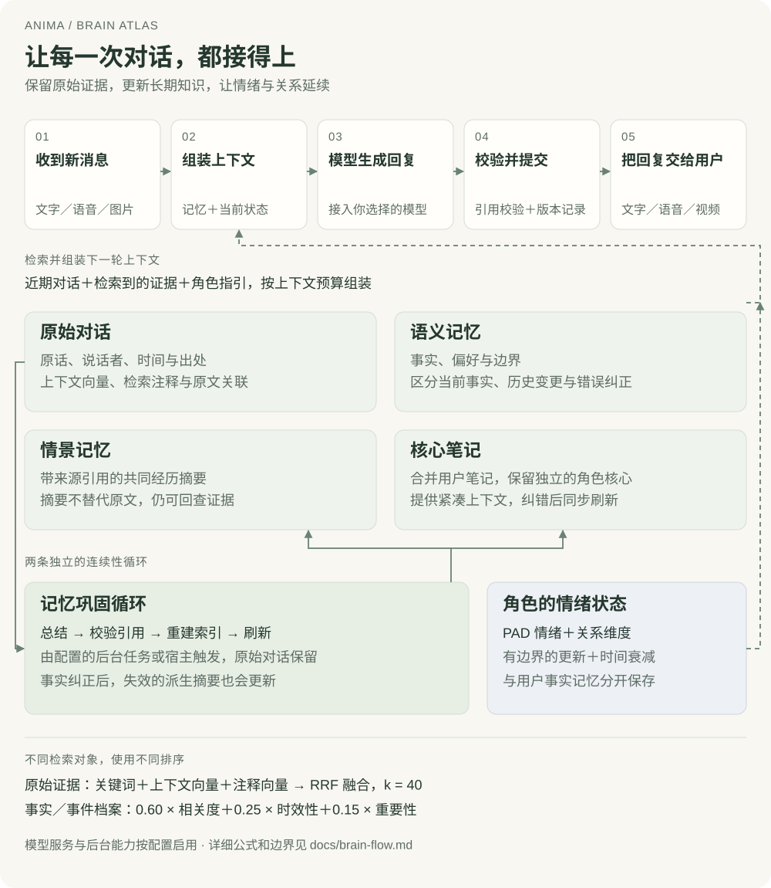

<p align="center">
  <a href="https://www.anima-lab.io"></a>
</p>

<h1 align="center">Anima Brain</h1>
<p align="center">
  <a href="README.md" lang="en">English</a> &nbsp; | &nbsp; <strong>简体中文</strong>
</p>
<p align="center"><strong>为 AI 伙伴提供长期记忆与情绪连续性。</strong></p>
<p align="center">
  Python 3.11+ &nbsp; · &nbsp; Alpha 0.6.0 &nbsp; · &nbsp; 代码采用 MIT 许可证
</p>
<p align="center">
  <a href="#demo-clips">效果演示</a> &nbsp; / &nbsp;
  <a href="#quickstart">快速开始</a> &nbsp; / &nbsp;
  <a href="#python-sdk">Python SDK</a> &nbsp; / &nbsp;
  <a href="#connect-your-agent">接入现有 Agent</a> &nbsp; / &nbsp;
  <a href="docs/README.md">开发文档</a> &nbsp; / &nbsp;
  <a href="#try-anima">体验 Anima</a>
</p>

做一个能聊天的角色不难，难的是让下一次聊天真正接得上：记得用户说过什么，分清哪些事情已经变了，也保留相处过程中的熟悉感。

Anima Brain 为此提供 **持久记忆、角色设定和情绪连续性**。你可以在 Python 里直接调用，也可以通过 MCP 接到已有 Agent，或者用自己的前端做产品。回复模型由你选择；想先看看实际效果，可以启动仓库自带的 [Companion Studio 网页示例](examples/showcase/README.md)。

项目对外名称为 **Anima Brain**。为兼容已有接入，Python 包名仍是 `companion-engine`，导入使用 `companion_engine`，命令行入口仍是 `companion`。

项目源于 [Anima Lab](https://www.anima-lab.io) 的记忆与角色架构，并针对 Python 开发者重新组织了存储、配置和接口。**这里是独立适配的开发工具，不是 Anima 线上后端的完整开源版；默认设置和能力范围也不完全相同。** 具体差异见[架构说明](docs/architecture.md#source-provenance-and-non-parity)。

## 能给你的 Agent 加上什么

| 能力 | 具体做什么 |
| --- | --- |
| **有出处的记忆** | 保存原始对话、带引用的事实、纠错记录，以及帮助检索的注释和证据关联，方便回看一条记忆是怎么来的。 |
| **跨对话的连续性** | 本地关键词检索、可选向量检索、有限次数的补查，以及带来源的核心笔记和事件摘要。 |
| **角色与表达** | 配置角色性格、表达偏好，记录当前对话的情绪线索与回应意图；还可启用虚构的角色情绪和关系状态。 |
| **多模态能力** | 通过分别配置的服务接入看图、生成图片、参考图编辑、语音合成和转写。 |
| **实时通话** | 流式 Doubao 语音识别接入同一套对话与记忆流程，再用角色音色回复；可选 Vidu S2 驱动动态视频，通过托管 RTC 传输。 |
| **应用层控制** | 类型化返回值、记忆审核、上下文预算、用量记录，以及按请求 ID 重放结果，便于处理重试。 |

数据保存在本地 SQLite 中，关键词检索使用 FTS5，不依赖 Anima 账号或 Convex 后端。

**Python 核心包不依赖前端。** 可选的 React 展示页放在 `examples/showcase/`，可以聊天、编辑记忆、查看模型实际收到的上下文。支持 MCP Apps 的宿主还可以显示记忆操作卡片和语音播放控件。

<a id="demo-clips"></a>

## 先看看实际效果

从本地展示页和 Python SDK 的英文演示中，单独剪出了三段。**点击预览图，打开播放器即可听到声音。**

| 角色语音 · 6.5 秒 | 实时语音通话 · 5.9 秒 | 动态视频通话 · 6.6 秒 |
| --- | --- | --- |
| [](https://spearsheep.github.io/anima-brain-demos/#voice-message) | [](https://spearsheep.github.io/anima-brain-demos/#audio-call) | [](https://spearsheep.github.io/anima-brain-demos/#video-call) |
| 用角色音色读出一句自然的回复 | 语音输入 → 大脑处理 → 角色语音回复 | S2 动态形象与声音通过同一 RTC 会话录制 |

[打开全部演示](https://spearsheep.github.io/anima-brain-demos/) · [下载 4K 片段](https://github.com/spearsheep/anima-brain/releases/tag/demo-media-2026-11) · [录制说明与接入方式（英文）](docs/demos.md)

这些功能需要配置相应的模型服务。语音通话保留了真实调用产生的回复，界面经过重录；视频通话的画面与声音来自同一次 RTC 录制，保持同步。成片为 4K，里面的动态人物画面保留服务商实际输出的分辨率。

<a id="quickstart"></a>

## 快速开始

需要 Python 3.11+，以及支持 FTS5 的 SQLite。先下载仓库，再运行离线示例：

```bash
git clone https://github.com/spearsheep/anima-brain.git
cd anima-brain
python3 -m venv .venv
source .venv/bin/activate
python -m pip install -e .
python examples/offline_demo.py
```

这个离线示例使用虚构数据，**不会调用模型，也不需要 API key**，适合先了解记忆如何保存和更新。

要开始真实对话，再配置兼容 Chat Completions、支持 JSON 对象输出的模型服务：

```bash
export COMPANION_BASE_URL='https://your-provider.example/v1'
export COMPANION_MODEL='your-model-id'
# 在 Bash 中输入密钥，避免把密钥内容写进命令历史。
read -s -p 'API key: ' COMPANION_API_KEY
export COMPANION_API_KEY
python examples/chat.py
```

把地址和模型名换成你的服务配置。模型调用使用你自己的账号额度，项目不会自动替你选择服务商或模型。

终端示例默认会检索记忆，但不会为了规划补查额外调用模型。更多选项见 `python examples/chat.py --help`，包括补查次数、历史窗口和记忆写入策略。

## 想先体验交互？启动网页示例

[](examples/showcase/README.md)

Companion Studio 延续了 Anima 的纸张与墨色风格，支持角色切换、聊天、记忆审核和来源查看。它调用的就是 SDK 的实际实现，可以作为你搭建自己前端时的参考。

除上面的 Python 环境外，还需要 Node.js 22.12+ 和 npm。

```bash
python -m pip install -e '.[http,calls]'
npm ci --prefix examples/showcase
npm run build --prefix examples/showcase
python examples/showcase/serve.py --open
```

启动后可以在页面里配置模型。只想预览界面时，在最后一条命令末尾加 `--demo`，页面会明确标注这是使用预设回复的离线演示。

展示页也接入了[实时语音与动态视频通话](docs/live-calls.md)，需要另行配置对应服务和角色音色。完整说明见[安装、功能与存储位置](examples/showcase/README.md)。

这是供单个用户在本机运行的示例。如果要部署给多人使用，需要自行接入身份验证、权限和部署服务。

## 这套“大脑”怎么工作

[](docs/assets/brain-flow.zh-CN.svg)

[打开完整 SVG](docs/assets/brain-flow.zh-CN.svg) · [查看中文动图](docs/assets/brain-flow.zh-CN.gif) · [完整机制说明（英文）](docs/brain-flow.md)

启动展示页后，打开[中文交互架构图](http://127.0.0.1:8787/?view=architecture&lang=zh-CN)，可以逐步播放四条流程。页面顶部可切换 **English / 简体中文**：

- **记忆怎么分工**：原话保留细节；语义记忆保存事实和偏好；情景记忆记录发生过的事；核心笔记把长期信息整理成紧凑的上下文。
- **怎么把相关信息找回来**：展示实际使用的 RRF 排序，以及待跟进事项如何结合重要性、情绪强度、时间衰减和日期紧迫度排序。这是两套不同的分数。
- **历史怎么整理、旧信息怎么更新**：从达到整理阈值，到写摘要、校验来源、刷新索引；事实被纠正后，受影响的摘要也需要更新。
- **情绪怎么延续**：展示角色的 PAD 状态、关系维度、衰减速度和变化限制，并可拖动参数观察结果。

README 直接使用矢量图，并加大了字号；放大查看时文字仍保持清晰。动图作为单独的入口保留。交互页需要启动本地展示服务，采用适合逐步演示的布局；图内标注、步骤说明与公式演示均提供中英文，两种语言共用流程与计算逻辑。所有示例都不会调用模型或读取你的私有聊天；交互页支持暂停、逐步查看和减少动画模式。

文字聊天与通话共用同一套记忆流程。SDK 的 `brain.call(character_id, CallOptions(...))` 提供流式音频、转写、打断、静音及已保存的传递记录，详见[通话接入指南](docs/live-calls.md)。

<a id="python-sdk"></a>

## 在 Python 里接入

配置好模型后，可以从下面这个例子开始：

```python
import asyncio
from companion_engine import CompanionBrain, Settings

async def main():
    async with CompanionBrain(
        storage="./output/brain.sqlite3",
        user_id="alice",
        settings=Settings.from_env(),
    ) as brain:
        if not any(c.id == "mika" for c in brain.characters()):
            brain.create_character(
                character_id="mika",
                name="Mika",
                persona="说话直接，带一点俏皮。关心对方，但不说空泛的安慰话。",
            )

        reply = await brain.chat(
            "mika", "记一下，我平时更喜欢喝茶。", request_id="message-1",
        )
        print(reply.text)        # 给用户看的回复
        print(reply.memory_ids)  # 这次保存的记忆 ID

asyncio.run(main())
```

下次打开同一个数据库，并使用相同的 `user_id`，就能继续原来的对话。重试同一条消息时沿用 `request_id`；发送新消息时要换一个新的 ID。同步应用可以使用 `chat_sync()`。

常用配置分成三层：

| 配置入口 | 用来控制 |
| --- | --- |
| `Settings` | 模型服务、凭据和模型侧限制。 |
| `BrainConfig` | 记忆检索、最近对话窗口、上下文预算和回复提示。 |
| 角色设置 | 角色性格、记忆写入策略，以及是否启用关系状态等行为。 |

创建角色不会自动调用模型或生成头像。新建 SDK 角色默认启用记忆索引、知识冲突检查和摘要整理，配置好对应模型后由后台执行，因此会增加模型调用。已有角色显式关闭的设置会保留。具体机制、默认配置与原版的对应关系见[记忆架构对齐说明](docs/memory-parity.md)。

→ [SDK 使用指南](docs/sdk.md) · [记忆、视觉与媒体参数](docs/sdk-capabilities.md)

## 从一条消息到下一次对话

```text
你的应用 / Agent 宿主
        │
        ▼
  准备上下文 ─── 角色设定 + 最近对话 + 检索到的证据
        │
        ▼
  生成回复 ───── SDK 调用你的模型，或由 MCP 宿主生成
        │
        ▼
  校验并提交 ─── 原始对话 + 有出处的记忆提议 + 可选状态更新
        │
        ▼
  本地 SQLite ── 下一轮或下次打开时继续使用
```

记忆写入支持自动保存、审核后保存和关闭三种模式。**关闭事实写入，不等于停止保存对话历史**；读取、写入和历史保留是不同的控制项。来源校验检查的是引用是否有出处，并不能保证模型对这段话的理解一定正确。

SDK 已提供可选的语音通话与动态视频适配，但不包含完整的 Anima 消费端应用、线上托管设施、计费系统或主动联系用户的服务。能力边界见[架构文档](docs/architecture.md)。

<a id="connect-your-agent"></a>

## 接到现有的 Agent

如果你用的是 Claude Code、Claude Desktop 或 DeepSeek Harness，可以先生成本机的接入配置：

```bash
python -m pip install -e '.[mcp]'
companion --db ./output/host/brain.sqlite3 host-package ./output/hosts
```

接着按生成目录里的 `START-HERE.md` 操作。文件包含当前机器上的路径，因此换一台机器时应重新生成，不能把本机配置直接原样发给别人使用。接入后，回复仍由宿主自己的模型生成。

**连接上 MCP，意味着宿主可以调用这些工具；不意味着所有聊天都会自动被记录。** 宿主需要实际执行检索和保存操作，记忆才会参与对话。详见[Claude / DeepSeek 接入指南](docs/host-integrations.md)和[连接方式说明，含 ChatGPT](docs/connections.md)。

如果你的程序需要通过本机 HTTP/MCP 访问，可以安装 `.[http]`，再运行 `companion http`。`companion settings` 则只打开私有的服务配置表单。这两条命令本身都不会启动聊天网页。

<a id="try-anima"></a>

## 只想聊天？直接体验 Anima

这个仓库主要面向开发者。如果你想直接体验角色陪伴，无需自己安装或配置模型，可以使用 **Anima Lab**：

**[官网与网页版](https://www.anima-lab.io) · [iPhone / iPad](https://apps.apple.com/app/id6776954266) · [Android 下载](https://www.anima-lab.io/download)**

<p align="center">
  <a href="https://www.anima-lab.io"></a>
  &nbsp;
  <a href="https://www.anima-lab.io"></a>
</p>

*Rina 和 Sean 的展示图来自 Anima Lab 公开网站，用于介绍消费端产品；它们不是 SDK 预装的角色或能力。Android 通过官方页面提供 APK 下载。*

## 继续阅读

以下详细开发文档目前以英文为主：

| 你想了解什么 | 看这里 |
| --- | --- |
| 聊天、配置、记忆审核和异常恢复 | [SDK 使用指南](docs/sdk.md) |
| 记忆限制、看图、生图、语音合成与转写 | [SDK 参数与能力](docs/sdk-capabilities.md) |
| Claude 和 DeepSeek Harness 的安装接入 | [宿主接入指南](docs/host-integrations.md) |
| MCP 工具、CLI 和底层接口 | [功能参考](docs/features.md) |
| 检索公式、记忆整理和情绪变化 | [Brain Atlas 机制说明](docs/brain-flow.md) |
| Anima 架构的适配范围与实现边界 | [架构说明](docs/architecture.md) |
| 向量索引与摘要维护任务 | [记忆维护](docs/memory-automation.md) |
| 实时语音与动态视频通话 | [通话指南](docs/live-calls.md) |
| 参与开发、运行检查和准备发布 | [贡献指南](CONTRIBUTING.md) |

[全部文档](docs/README.md) · [验证记录](docs/verification.md) · [更新日志](CHANGELOG.md)

## 项目状态与许可证

当前为 Alpha 版本，从源码安装。接口、协议和持久化测试通过，不代表所有模型的对话质量都经过验证。角色情绪是虚构状态模拟，不是对用户的心理评估。

本地存储也不等于本地推理：配置远程模型后，相应上下文会发送给该服务。`user_id` 用于数据隔离，不是登录或鉴权机制；部署前请阅读[安全说明](SECURITY.md)。

代码采用 [MIT 许可证](LICENSE)。Anima 品牌标识与角色图片适用单独的[素材使用说明](docs/assets/README.md)，也不是运行 SDK 的必要依赖。

## 作者

Anima Brain 由 [Jun Yu Chen（@spearsheep）](https://github.com/spearsheep) 和 [@kayllla](https://github.com/kayllla) 共同开发。
