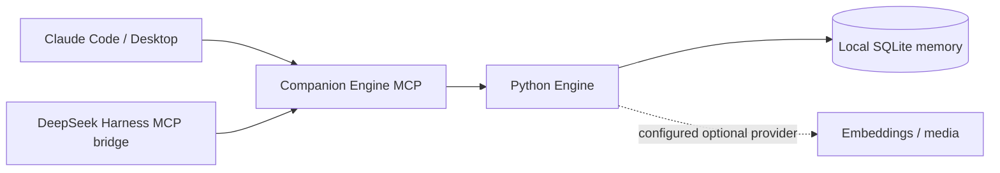

# Claude and DeepSeek Harness

Both hosts use the same Python Companion Engine through local stdio MCP. The
host model generates the reply, memory candidates and emotional appraisal;
Engine stores and retrieves them. No second reply-model API key is required by
Engine. Claude access or a configured DeepSeek Harness model is still required
by the host itself.



## Generate the local setup

Run from the repository with Python 3.11+ and MCP dependencies installed:

```bash
python3.11 -m venv .venv
.venv/bin/pip install -c constraints-tested.txt -e '.[mcp]'
.venv/bin/companion \
  --db ~/.local/share/companion-engine/hosts/brain.sqlite3 \
  --owner local \
  host-package ./output/hosts \
  --settings-file ~/.config/companion-engine/hosts/providers.json
```

This exports configuration only. It neither opens the database nor modifies host
settings. The output directory must be new. Paths use the current virtualenv and
are absolute, so regenerate after moving the installation or on a teammate's
machine. Do not commit generated local exports.

| Export | Purpose |
| --- | --- |
| `START-HERE.md` | Exact local paths and launch commands |
| `claude/.claude-plugin/plugin.json` | Claude Code plugin metadata |
| `claude/.mcp.json` | Local Engine process configuration |
| `claude/skills/companion-conversation/` | Copy of our canonical companion workflow |
| `claude-desktop-mcp.json` | Server entry to merge into Claude Desktop |
| `deepseek/companion.cordis.yml` | Harness overlay using its native MCP client |

The Cordis file uses JSON syntax, which is valid YAML. The exporter copies only
authored Markdown skill resources and generated configuration. It never copies
API keys, provider files, SQLite databases, media or chat histories. The
`--settings-file` argument selects a provider settings path; it does not embed
its contents. Chat-based credential configuration is disabled in both exports.

## Claude Code

```bash
claude plugin validate ./output/hosts/claude
claude plugin marketplace add ./output/hosts
claude plugin install companion-engine@companion-local
claude plugin list
```

Use `/mcp` inside Claude to inspect the connection and approve it when prompted.
The skill is scoped to intentional companion conversations, not unrelated coding.
The plugin is installed at user scope and appears in `/plugin` → Installed.
Restart existing Code sessions to load it. This local marketplace is not publicly
published. If a standalone `companion-engine` MCP entry was previously registered,
first verify `plugin:companion-engine:companion-engine` is Connected in
`claude mcp list`, then remove only the duplicate standalone entry with
`claude mcp remove companion-engine -s user`. Desktop configuration is separate.

## Claude Desktop

Open Desktop's developer configuration. On macOS it is:

```text
~/Library/Application Support/Claude/claude_desktop_config.json
```

Merge `mcpServers["companion-engine"]` from the exported Desktop file, preserving
other servers/settings, then restart Desktop. Do not register two copies of the
same Engine server in a host. Desktop can obtain the same workflow by calling
`get_companion_workflow`; the Claude Code skill directory is not a Desktop extension.

This setup targets local Desktop and Code, not claude.ai remote connectors.
An installer-style `.mcpb` bundle is not included.

## DeepSeek Harness

The tested baseline is `@deepseek-ai/dsh@0.2.2-rc.1`, with Node >=24.9.0. The
development-preview API can change, so retest before upgrading this pin.

```bash
npm install -g @deepseek-ai/dsh@0.2.2-rc.1
dsh plugin --profile web add "$PWD/output/hosts/deepseek"
dsh web
```

This installs a native bundle named `companion-engine-dsh`. It appears as
**Companion Engine** in **Plugins → Installed plugins**, with an enable switch.
The CLI package operation requires pnpm on PATH. Configure the model through Harness.
The bundle adds
`@deepseek-ai/dsh-mcp-client`; it does not change the model, default persona,
other tools or existing profiles. Tools appear as
`mcp__companion_engine__prepare_turn`, `mcp__companion_engine__commit_turn`, etc.
The server's instructions point to `get_companion_workflow`.

Installation persists the bundle selection in the web profile's package.json.
Do not also pass the old `--patch companion.cordis.yml` option: it would register
the same MCP namespace twice. Disabling/uninstalling the bundle does not delete
the Engine database. Harness scrubs ambient credential-like
environment variables before spawning MCP servers. Prefer Engine's private local
provider settings UI over putting keys into the patch.

An isolated local installation, without replacing the system Node, also works:

```bash
npm install --prefix output/host-runtime --no-audit --no-fund \
  node@24.11.1 @deepseek-ai/dsh@0.2.2-rc.1 pnpm@10.20.0
export PATH="$PWD/output/host-runtime/node_modules/node/bin:$PWD/output/host-runtime/node_modules/.bin:$PATH"
node output/host-runtime/node_modules/@deepseek-ai/dsh/lib/bin.js plugin \
  --profile web add "$PWD/output/hosts/deepseek"
node output/host-runtime/node_modules/@deepseek-ai/dsh/lib/bin.js web
```

## First conversation and memory checks

Ask the host:

> Use Companion Engine for this conversation. Read get_companion_workflow,
> list my characters and help me select or create one. Use your own model for
> replies and summaries. Prepare each actual user turn and commit the exact
> reply with grounded memory and appraisal.

Then verify these observable actions in the host's tool history:

1. Select/create a test character. Say “Please remember my test drink is tea.”
   Check a successful `commit_turn` with a quoted, consented memory.
2. Open a new host session, select the same character and ask for the test drink.
   Check retrieval, without copying the prior conversation into the new session.
3. Correct it to coffee. Check that the stored current fact is corrected rather
   than leaving conflicting current facts. A later session should retrieve coffee.
4. Check that the exact saved reply matches the displayed reply. If tool use is
   skipped, the integration has not demonstrated reliable per-turn persistence.

Both exports share the selected database and owner, so a fact saved via Claude
can be recalled via Harness. For separate memories, export with a different
database or owner. Owner is a trusted local namespace, not an authentication
system. Avoid simultaneous turns for the same character across hosts; Engine
allows one pending turn per owner/character and returns a conflict otherwise.

Without provider configuration, lexical memory and host-authored summaries work.
Configured embedding/maintenance providers may make API calls when the server
runs. The isolated settings path in the example starts separately from existing
Engine provider settings. Use the same database/settings path with `companion settings`
to configure optional providers, or set the corresponding environment variables.
Install `.[http]` for the private settings form. Retrieved context reaches the host model;
local storage does not mean inference stays on the laptop.

## What has been verified

On 2026-11-10, native plugin installation was also verified locally:
Claude Code lists `companion-engine@companion-local` as enabled, and its
plugin-owned MCP reports Connected. The duplicate standalone Code MCP registration
was removed. Harness's actual Plugins page shows **Companion Engine** under
Installed plugins with its switch on. The existing launch script was updated to
omit the redundant command-line patch. Python host/CLI tests: 4 passed.
Exports used for this installation live under `output/native-plugins-20261110`;
keep that directory while Harness's local linked package is installed.

On 2026-11-06:

| Check | Status |
| --- | --- |
| Claude Code 2.1.42 official plugin manifest validator | Passed; optional author warning |
| Harness 0.2.2-rc.1 / Node 24.11.1 official profile composition | Exported overlay loaded |
| Actual Harness Cordis MCP bridge + tool registry | 48 tools registered; write, fresh-session recall and retry passed |
| Python MCP with both exported command definitions | Cross-process persistence, corrections, idempotency, owner/character isolation passed |
| Full Engine Python regression tests | See current test output / verification document |
| Claude/DeepSeek model-driven conversations | Not tested in this integration pass |
| Claude Desktop launch / host-specific inline audio or image UI | Not tested in this integration pass |

Protocol checks are not proof that a host model will always follow the workflow.
Media rendering is host-dependent; hosts without MCP Apps need their own media integration.
A successful tool call alone does not establish playback. Existing ChatGPT integration remains separate.

Repeat the offline checks:

```bash
.venv/bin/pytest tests/test_hosts.py tests/test_mcp.py -q
output/host-runtime/node_modules/node/bin/node examples/deepseek_bridge_smoke.mjs \
  output/host-runtime output/hosts/deepseek/companion.cordis.yml
```

The JS smoke test runs the real installed Harness bridge against a disposable
Engine database, performs tool calls directly, reconnects and deletes its test
data. It makes no inference calls. It does not test the full agent loop.

Official integration references:
[Claude plugins](https://code.claude.com/docs/en/plugins-reference),
[Claude MCP](https://code.claude.com/docs/en/mcp),
[DeepSeek Harness memory MCP](https://deepseek-harness.github.io/deepseek-harness/en/guide/mcp-memory).
