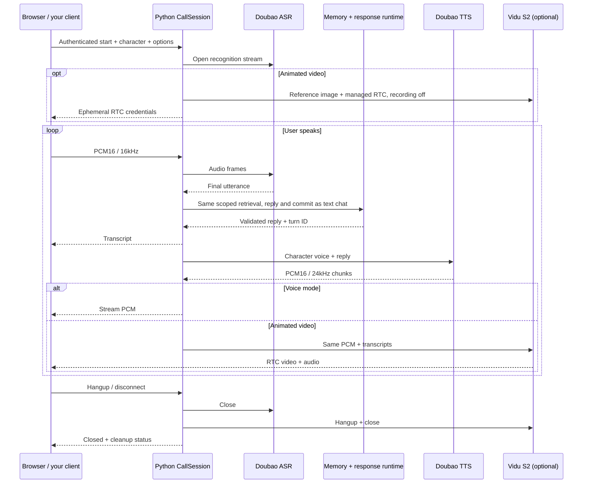

# Live voice and animated video calls

The optional call module carries an actual conversation through the same memory and emotion runtime as text chat. It is a streaming cascade: **Doubao ASR → Companion Engine → Doubao TTS**. Video adds **Vidu S2 Component + managed Volcengine RTC**. Vidu receives the reply audio and transcripts; it does not run a second reply model.

The Python API is independent of the showcase. The showcase is a local, single-owner reference host. To deploy elsewhere, build an authenticated host around `CallSession`; its PCM and event API does not depend on a browser or localhost.

## Start in Companion Studio

```bash
python -m pip install -e '.[http,calls]'
npm ci --prefix examples/showcase
npm run build --prefix examples/showcase
python examples/showcase/serve.py --open
```

Configure the chat model as usual. In **Settings → Voice**, select Doubao, a supported expressive TTS model and its key. In **Settings → Calls**, set the ASR key and the resource granted to that account (for example `volc.seedasr.sauc.duration` or `volc.bigasr.sauc.duration`). Different accounts can have different grants; a TTS key is not necessarily an ASR key.

Set the character’s **voice ID** in Edit. To enable animated video, also upload that character’s appearance reference and configure a **Vidu key**. The adapter requests S2 Component with managed Volcengine RTC and provider recording disabled. No separate Volcengine RTC application credentials are needed for this mode.

Use the phone or video button beside the conversation name. The invitation screen lets you choose the recognition language. Start explicitly requests the microphone. Your camera is off until you enable it. Controls provide mute, camera, interrupt and hangup. Connection and avatar preparation are visible; video is marked ready only after the browser decodes a frame. Headphones are recommended to reduce speaker echo.

The showcase uses 10-minute calls. It never reconnects automatically after a failed call. Closing the dialog or page releases media devices, audio contexts, the RTC room and provider sockets.

To test with an audio file instead of a microphone, use
[`examples/call_from_wav.py`](../examples/call_from_wav.py). It accepts a PCM16 mono
16kHz WAV, runs the real call pipeline and saves the reply as a 24kHz WAV.

## Python SDK

```python
import asyncio
from companion_engine import CompanionBrain, CallOptions, Settings

async def call_with_transport(brain, character_id, input_frames, send_to_client):
    # input_frames: your transport's asynchronous PCM16 mono 16kHz source
    # send_to_client: your application's event/audio delivery function
    async with brain.call(character_id, CallOptions(mode="voice", language="en-US")) as call:
        async def receive():
            async for pcm in input_frames:
                await call.send_audio(pcm)  # 1..6,400 bytes, even length; <=200ms
            await call.close()

        async def deliver():
            async for event in call.events():
                await send_to_client(event)
                # event.audio: PCM16 mono 24kHz. event.sequence identifies the reply.
                # JSON events: state, transcript, partial, avatar, interrupted,
                # audio_end, muted, notice, error, closed.

        await asyncio.gather(receive(), deliver())

async def main(input_frames, send_to_client):
    async with CompanionBrain("./output/brain.sqlite3", settings=Settings.from_env()) as brain:
        # Create/configure a character with voice_id before opening the call.
        await call_with_transport(brain, "rina", input_frames, send_to_client)
```

For video, set `mode="video"`. The `avatar` event provides an ephemeral RTC room token and IDs for the browser’s Volcengine RTC client. Subscribe to the remote stream without publishing another microphone feed. The video room supplies the avatar’s synchronized audio; **do not also play the PCM audio events**, or the user will hear double audio.

Other controls:

```python
await call.mute(True)       # keeps the ASR connection alive with silence
await call.interrupt()      # stop current synthesis/queued audio; Vidu interruption signal
call.set_frame(image_input) # optional ImageInput camera snapshot, video mode only
call.set_frame(None)        # clear the snapshot when camera sharing ends
await call.close()          # idempotent; also called by async context manager
receipts = brain.call_history("rina")
```

A camera snapshot is used only if it is fresh at the start of a user turn (default five seconds). The showcase samples at most once every two seconds and sends a JPEG no wider than 640 pixels. It does not send continuous camera video to the reply model. The configured vision model interprets the snapshot; observations remain distinct from user statements. Existing media context logging can persist observations or image references when enabled; the call does not record a camera movie.

## Transport and persistence



Normal turns, source evidence, permitted memories and character-state changes use the existing SQLite pipeline. Additional `call_sessions` and `call_turns` tables record mode, timestamps, provider session locator, turn IDs, delivery status and bytes sent. Provider keys and RTC tokens are not stored in these receipts. Raw microphone and synthesized audio are not saved by the call module.

**Generated does not mean heard.** A response is committed before speech is sent. Receipts distinguish `generated`, `not_played`, `audio_sent`, `interrupted` and `failed`. `audio_sent` means bytes were sent to the transport, not that the user listened. An interruption note is added to subsequent call context. Full generated text is retained in history; there is no word-level “heard transcript.”

Review-mode characters still require approval: a call stops after a reply that needs review. Approve or decline it in text chat. Calls never bypass this setting. Concurrent text chat to the same character is blocked while its call is active; different characters retain separate scopes.

## Lifecycle, failures and hosting

Use nested async context managers. A synchronous `brain.close()` refuses to close a brain with live sessions; the async brain context closes its sessions first. Audio/avatar sockets close promptly on hangup; an already-running reply request is drained before SQLite is closed and may still be billed.

After a crash, inspect `brain.call_history(character_id)`. A starting/active/cleanup-required record prevents another call for that character. Once you have confirmed no other process owns that session, run:

```python
await brain.recover_call(call_id)
```

Recovery sends a Vidu hangup for a known session ID. If the create outcome was unknown or the provider cannot confirm cleanup, check its console, stop any live session there, and only then use `confirm_provider_stopped=True`. There is no automatic paid-create retry or blind deletion of the receipt.

For a public host, supply your own authentication, owner mapping, secure WebSocket origin rules, HTTPS, quotas and rate limits. Protect both media artifacts and RTC credentials. Configure your CSP for the provider’s actual RTC/WebSocket endpoints. The showcase allows outbound HTTPS/WSS for RTC and holds its bearer token locally; its loopback guard deliberately prevents treating it as a public server.

This first version waits for the complete structured reply before synthesis. That preserves the existing validation/commit semantics but adds latency; it is not an end-to-end low-latency speech model. Browser echo cancellation, sustained speech-onset interruption and exact transcript echo rejection are practical protections, not perfect acoustic separation. Network conditions, voice language and browser autoplay policies still matter.

Provider references: [Vidu S2 Component parameters](https://platform.vidu.com/vidu-stream/doc/s2-avatar/component/parameters), [Doubao streaming ASR](https://docs.volcengine.com/docs/doubao-voice/large-model-streaming-automatic-speech-recognition-api-1?lang=en).
