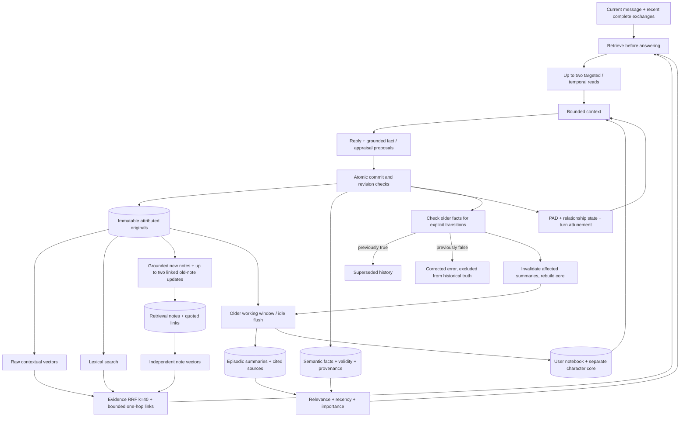

# Memory architecture: Anima production concepts, implemented in Python

This is the architectural alignment of Anima Brain with the owner's `makima.io` backend.
It preserves separate evidence, semantic facts, episodic summaries, core notebooks and
character state. SQLite replaces Convex infrastructure; it does not replace those mechanisms
with a single chat summary. This document describes executable paths, not a benchmark claim.

## From a conversation to the next response



## Mechanism mapping

| Mechanism in the original backend | Python execution path | Preserved behavior |
| --- | --- | --- |
| `conversationEvidencePolicy.ts`, `conversationEvidenceActions.ts` | `evidence_index.py`, `Runtime.index()` | Raw embedding input includes speaker, observed time, original excerpt, and the previous two attributed messages (up to 600 characters each). No future reply becomes user context. |
| Raw and contextual-note embedding lanes | `evidence_chunks`, `evidence_embeddings` | 1,400-character chunks, 180-character overlap, at most the first 24k characters indexed; complete originals retained. Notes add description and keywords in a separate vector lane. Python offsets count Unicode code points, not JavaScript UTF-16 units. |
| `memoryNotePolicy.ts` old-note evolution | `note_evolution.py`, `Runtime.maintain()` | At most three typed links and two old-note updates; exact original quotations on both sides, all inspected dependencies/revisions rechecked, atomic write. Unrelated follow-on events remain new notes. |
| Evidence retrieval | `MemorySystem.recall()` | Raw-vector top 32, note-vector top 16, lexical top 60, RRF `Σ 1/(40+rank)`; up to six one-hop linked additions from four seeds. No recency penalty on original evidence. Matched chunk offsets and causal context accompany results. |
| `ai.ts` scored archive retrieval | `LayeredMemory.search()` | Facts/episodes rank by `0.6 × relevance + 0.25 × exp(-age_days/45) + 0.15 × importance/10`. Facts use event date when known, otherwise reinforcement time; episodes use the end of their cited observation span. |
| Fact metadata/reinforcement | `MemoryDetails`, `MemoryLifecycle`, `Knowledge` | Separate event, observation, reinforcement and state-validity clocks; importance/confidence, subject, state key, emotion, open-loop and follow-up policies. Repeated exact claims reinforce without retiming the event or silently changing metadata. |
| `memoryTemporalActions.ts` reconciliation | `Knowledge.prepare/apply()`, `Runtime.reconcile()` | Same-state-key, lexical/semantic and paginated older candidates. Similarity never retires a fact. Require explicit change/correction, exact quotes, later observation and unchanged revisions. Cross-key updates are supported; old source text is preserved. |
| `memoryActions.ts` consolidation | `Runtime.maintain()`, `consolidate_pair()` | Citation-backed episodes, structured user notebook and optional separate character core. Preserve grounded dates, importance/emotional metadata and unresolved threads. Invalidations force core repair. Original evidence is not compressed away. |
| Bounded reader and temporal planner | `Runtime.context()`, `temporal.lookup()` | At most two extra reads: focused query, source expansion or typed temporal query. Current/history/as-of/event/observation lookups distinguish clocks and unknown validity. A plan is never presented as evidence. |
| Local replacement for cloud scheduling | `Automation` worker | Durable backlog and reconciliation cursors, one leased job per character, provider calls outside SQL transactions, usage receipts, revision checks and explicit review after uncertain failure. |

**When embeddings are unavailable:** lexical recall remains available. Archive ranking uses
an explicitly labelled normalized lexical-rank proxy for relevance; this is not a cosine score.
`search()` returns score components so the fallback and each ranking contribution are inspectable.
Retired, suppressed, stale, future and ineligible low-importance facts do not enter ordinary
prompt retrieval. Explicit time/history tools remain available for historical questions.

## Defaults and how to run them

New `CompanionBrain` SDK characters enable background summaries, reconciliation, embedding
indexing and semantic retrieval. They require configured providers: a reply/summary model for
writing; an embedding model for vectors. No keys or providers are invented. The default worker
starts while the brain context manager is open. An explicit persisted off policy stays off.

```python
from companion_engine import BrainConfig, CompanionBrain, Settings
from companion_engine.automation import MemoryAutomation

config = BrainConfig(
    recent_turns=10,  # user/assistant pairs, also bounded by recent_chars
    automation=MemoryAutomation(
        embedding=True, semantic_retrieval=True,
        summaries=True, reconcile=True,
        summary_turns=20,
        summary_batch_messages=20,
        retain_recent_turns=10,
        idle_seconds=300,
        daily_jobs=100,
    ),
)
with CompanionBrain("brain.sqlite3", settings=Settings.from_env(), config=config) as brain:
    # Create a character, then await brain.chat(...) / call brain.chat_sync(...).
    # For an existing explicitly configured character, change its policy deliberately:
    # brain.configure_automation(character_id, config.automation)
    pass
```

Summary thresholds are 20 pending turns, 12k pending characters, 300 seconds idle, or a
knowledge invalidation. Busy conversations retain the newest 10 exchanges; idle flush handles
short conversations too. One job processes up to 20 original messages (configurable 2–60),
within a 48k source-character budget. Direct `runtime.maintain(cid, request_id)` explicitly
flushes the recent window; the automatic worker calls it with `flush=False`.
`memory_max_output_tokens=8192` is independent of short conversational reply limits.

Reconciliation precedes consolidation. Each job checks one new fact against a bounded page,
with persistent progress; it is not a full database rewrite on every turn. The daily limit is
jobs, not dollars. Notes, reconciliation, summaries and embeddings add provider calls and
usage receipts. Provider/validation failures pause that character's maintenance for review;
there are no silent automatic paid retries. A stopped local process cannot run maintenance.

MCP-only integrations keep host-written summaries by default. The host can call
`prepare_knowledge_reconciliation` / `commit_knowledge_reconciliation` and
`prepare_note_evolution` / `commit_note_evolution` using its own model, without a backend LLM
key. Snapshot IDs reject stale host writes. `configure_host_summaries` disables autonomous
summary/reconciliation calls. Hosts must actually invoke these tools; plugin installation
alone does not make the model execute them. Existing HTTP/CLI runtimes retain their persisted
policy; inspect `memory_status` instead of assuming that upgrading code enabled old characters.

## Existing databases and inspectable records

Migration creates causal source representations, chunk offsets and fact lifecycle records
locally. It preserves transcripts, source IDs and revisions and makes no provider calls.
Legacy vectors are not relabelled as contextual vectors. New indexing builds raw/note lanes;
legacy raw scores are ignored once a contextual raw vector is available for that source/model.
A note edit invalidates its note lane, not the unchanged original lane. Derived document/fact
text edits still invalidate their own vectors through SQLite triggers.

Useful tables: `evidence`, `evidence_context`, `evidence_chunks`, `notes`, `note_dependencies`,
`evidence_links`, `evidence_embeddings`, `memories`, `memory_details`, `fact_lifecycle`,
`revisions`, `fact_reconciliation`, `documents`, `document_metadata`, `notebooks`,
`knowledge_updates`, `memory_jobs`, `operations`, `provider_usage`.

Keep `capture_context=True` when auditing exactly what the answering model received.
The memory APIs expose source IDs, timestamps, metadata, lifecycle and retrieval ranking
components. Full originals remain available through evidence expansion.

## Validation and deliberate local differences

`tests/test_memory_architecture_parity.py` covers causal pronoun context, raw/note vector
invalidation, chunk retrieval, quoted old-note evolution, ranking, reinforcement clocks,
cross-key supersession, explicit corrections, additive non-conflicts, stale-write rejection,
worker execution, temporal reader routing and MCP host application. Existing suites cover
owner isolation, persistence, leases, consent, deletion, multimodal chat and plugin contracts.
These are deterministic/offline integration checks, not measurements of model judgment quality.

Local exact-vector scans replace Convex vector indexes; a process worker replaces cloud cron.
Source/character isolation and model namespaces are retained. Same-key edits still require
explicit revisions; a repeated fact cannot silently mutate its importance or provenance.
Original production rollout switches are not copied: this is a configurable independent SDK.
No production quality equivalence, infinite history, perfect conflict detection or zero-cost
maintenance is claimed. A fixed-conversation retrieval/reconciliation evaluation with real
providers is still needed to compare behavioral quality against the deployed Anima backend.
