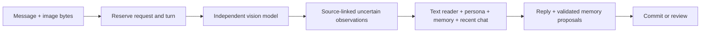

# SDK configuration: memory, vision and media

The SDK has three configuration layers. It calls providers only for a requested
operation or an explicitly enabled maintenance policy. Creating a character does
not generate an avatar, synthesize a voice, or index anything remotely.

| Layer | Configure here | Examples |
| --- | --- | --- |
| Application | `Settings`, `BrainConfig` | Provider endpoints/models/keys, memory retrieval, context budgets, optional maintenance |
| Character | `create_character(...)`, `update_character(CharacterSpec)` | Persona, core persona, appearance, voice, timezone, relationship flags, memory write policy |
| Request | `chat`, `generate_image`, `speak`, `transcribe` | Text, local image/audio inputs, generation options, stable request ID |

Existing text-only code still works. Async methods also have blocking `_sync`
versions. This is the Python application SDK; host tools do not expose every new
SDK option or accept these attachment objects. No standalone chat frontend is bundled.

## Memory: reading, writing and storage are different

```python
from companion_engine import BrainConfig, MemoryConfig, MemoryAutomation

config = BrainConfig(
    context_chars=48000,
    recent_turns=6,       # complete user + assistant exchanges
    recent_chars=12000,   # whole pairs; oldest removed first
    memory=MemoryConfig(
        read_enabled=True,
        evidence_limit=8,  # original conversation excerpts
        fact_limit=12,     # current facts, including pinned boundaries/style
        document_limit=8,  # cited core/episode documents
        context_chars=16000,
    ),
    automation=MemoryAutomation(),  # explicit opt-out of default background maintenance
    capture_context=False,
)
```

Limits apply to the **final delivered context**, including after follow-up searches.
They are maxima, not promises to fill all slots. Boundary/corrected facts take
priority in the fact lane. Calendar, open-loop, style and continuity metadata also
consume the memory character budget; they are not extra unbounded context. Recent
history has its own budget. The total envelope is additionally bounded by
`BrainConfig.context_chars`; persona/current message/media observations are retained,
and impossible envelopes raise an error. Whole entries are omitted, never clipped
mid-quote. Budgets are serialized **characters**, not tokenizer-specific token caps;
the provider system instructions and JSON schema add overhead.

| Setting | Effect |
| --- | --- |
| `MemoryConfig(read_enabled=False)` | No old facts, originals, summaries, old attunement, calendar/style/loop metadata or follow-up memory searches enter the reply context |
| `memory.context_chars=0` | Same read-disable behavior |
| `memory_policy="automatic"` on character | Grounded model proposals may be saved with the reply |
| `memory_policy="review"` | Proposals wait for `approve(..., retain=True/False)` |
| `memory_policy="off"` | New fact writes/corrections disabled; this does not disable reading existing memories |
| `recent_turns=0` or `recent_chars=0` | No recent transcript pairs in the prompt |
| `relationship_enabled=False` | No fictional character relationship/mood state |

All modes still persist the conversation and original evidence. Read-disable is an
application context policy, not data deletion or an authorization boundary. Explicit
`history()`, `memories()` and the low-level Engine remain available to trusted code.
To test without old conversational information, disable memory reads **and** recent
history. Disable relationship simulation too if you want no accumulated character state.
App and character persona remain present. Read/write settings do not erase old data.

Manual, application-approved facts can use `brain.remember(character_id, MemoryDraft(...))`.
`brain.delete_memory(character_id, memory_id, expected_revision=...)` invalidates that
fact and affected derived memories; original conversations remain stored. Whole-character
deletion/export is a lower-level Engine operation. Generated-file retention and cleanup
remain application responsibilities; deleting a database record does not erase its media file.

Vector retrieval is optional: set `embedding_base_url`, `embedding_model` and
`embedding_key`, then enable indexing and semantic retrieval explicitly:

```python
brain.configure_automation("mika", MemoryAutomation(
    embedding=True, semantic_retrieval=True,
    summaries=True, summary_turns=4, summary_chars=12000,
    idle_seconds=300, daily_jobs=100,
))
```

New-character defaults come from `BrainConfig.automation`. Existing policies survive
reopening. The worker runs only while the brain is open and `start_worker=True`.
Summary thresholds are alternatives: enough turns, enough characters, or idle time.
`host_summaries=True` is for an external host authoring summaries; it is mutually
exclusive with backend `summaries=True`.

`summary_base_url`, `summary_model`, `summary_key` can select a separate summary model.
When all are unset, enabled summaries use the reply provider. Setting an incomplete
summary endpoint/model does not silently fall back. Basic fact extraction still occurs
inside the reply call. Explicit `brain.runtime.index(...)` and `maintain(...)` remain
available for controlled jobs. Review receipts before retrying uncertain failures.

## Provider configuration

| Capability | `Settings` fields | Protocol |
| --- | --- | --- |
| Reply + optional follow-up planner | `base_url`, `model`, `api_key` | Chat Completions JSON output, or injected `Provider` |
| Vision | `vision_base_url`, `vision_model`, `vision_key`, `vision_max_output_tokens=1200` | Chat Completions with image content blocks and JSON output |
| Embeddings | `embedding_base_url`, `embedding_model`, `embedding_key` | `/embeddings` |
| Summaries | `summary_base_url`, `summary_model`, `summary_key` | Chat Completions JSON output; optional separate model |
| Image generation/edits | `image_base_url`, `image_model`, `image_key` | GPT Image-compatible `/images/generations` and multipart `/images/edits` |
| Speech | `speech_provider`, `speech_model`, `speech_key` | ElevenLabs, MiniMax or Doubao adapter |
| Transcription | `transcription_base_url`, `transcription_model`, `transcription_key` | Multipart `/audio/transcriptions`, JSON text result |

`timeout_seconds` controls reply/planner/summary HTTP operations.
`media_timeout_seconds=120` controls vision/image/speech/transcription operations.
The current embedding adapter has its existing 120-second HTTP timeout. Timeouts
apply to HTTP operations, not a hard deadline for an entire chat workflow.

`brain.capabilities()` reports **configured capabilities**, without network calls.
It does not verify credentials, a model's modality support, or available provider
quota. Speech also needs a character voice ID or request override. Each configured
endpoint must actually implement the named protocol; a compatible text endpoint
does not imply image or audio support. No provider/model is selected implicitly.

`Settings.from_env()` loads saved settings plus `COMPANION_*` overrides, including
all fields above. `Settings()` loads none. See [`config.example.env`](../config.example.env).
Credentials stay out of capability output, context captures and operation receipts.

## Chat with actual images

```python
from companion_engine import ImageInput

reply = await brain.chat(
    "mika", "Does this outfit work for the interview?",
    attachments=[ImageInput(path="outfit.jpg", detail="high")],
    request_id="message-with-photo-1",
)
print(reply.text)
print(reply.generation["media"])
```

`ImageInput(data=jpeg_bytes)` also works. Exactly one of `path` and `data` is required.
Input limits: four distinct PNG/JPEG/WebP images, 10 MiB each, 20 MiB combined.
`detail` is `auto`, `low` or `high`. Headers are checked locally; the provider performs
actual decoding. Local paths are explicit caller inputs; the SDK does not download URLs.



The text reader receives **observations**, not the raw pixels. A text-only reply
model is therefore usable. Vision is question-aware, but this two-stage approach
can lose visual details; it is not direct end-to-end multimodal reasoning. Failure
to inspect an image is an error, not a silent text-only fallback.

The stored source reference is a SHA-256 content hash. A visual memory must quote
the corresponding observation and may not claim greater confidence than it. It
is labeled `host_observation`, distinct from a user assertion. An image of a jacket
does not establish who owns it. Input image bytes and local input paths are not
retained in the database or captured reply context; the observation, hash, model
and usage are retained. The vision provider receives the bytes. Keep originals in
your application's own media store if later visual reinspection is needed.

## Character pictures requested in chat

Set `BrainConfig(allow_chat_images=True)` to allow a reply to request one character
picture. The default is false; the optional Studio launcher enables it. An image
provider must also be configured. Ordinary conversation, image analysis, quoted
requests and explicit requests not to generate are instructed to leave the action empty.

```python
brain.set_appearance_reference("mika", ImageInput(path="character.jpg"))
reply = await brain.chat("mika", "Send me a selfie by the window", request_id="selfie-1")
print(reply.text, reply.image_result)
# Remove the saved reference (an appearance description can still be used):
brain.set_appearance_reference("mika", None)
```

The structured reply includes an optional image request citing the current user
message. The application checks capability and appearance, calls the existing image
adapter, and stores `image_result` with the turn. Its status is `succeeded`, `failed`,
`unavailable`, or `needs_appearance`; successful results include artifact metadata and
reported usage. `brain.history()` retains these results across restarts. Image usage
is separate from `ChatReply.usage` (text/reader/vision), and is in image operation receipts.
Each turn's image request is journaled: repeating a chat request does not buy a second
image, and uncertain provider failures are never automatically retried.

Reference bytes are stored privately per owner/character alongside generated media.
They go to the image provider, not the text reader; only reference availability and
appearance notes reach the reader. The HTTP character create/update body accepts
optional `reference_image` (base64 bytes to replace, null to remove, omitted to keep).
Finish/discard any pending turn before editing. Back up both SQLite and its media folder.

## Generate an image or use reference images

```python
from companion_engine import ImageInput, ImageOptions

result = await brain.generate_image(
    "mika", "Reading at a rainy cafe, candid photo",
    options=ImageOptions(size="1024x1536", quality="medium", count=1),
    references=[ImageInput(path="approved-character-reference.png")],  # optional
    request_id="cafe-image-1",
)
for artifact in result.artifacts:
    print(artifact.path, artifact.mime, artifact.bytes)
```

With explicit references, or a saved character reference, this calls image editing;
otherwise it calls generation.
The saved character `appearance` is included in either prompt. References improve
control but do not guarantee identical faces. Character creation never auto-generates
an image, and generated images do not silently become memory facts or replace an avatar.
Your application selects which result to display or retain as a future reference.

`ImageOptions` supports `size`, `quality`, `count` (1–4), optional `output_format`
(`png/jpeg/webp`), `background` (`auto/transparent/opaque`) and `input_fidelity`
(`low/high`, references required). Optional fields are omitted unless supplied.
Exact supported sizes/qualities/fidelity depend on your configured model; unsupported
requests surface errors and are not automatically rerouted. Transparent JPEG is
rejected locally. Only base64 PNG/JPEG/WebP outputs are accepted; URL-only providers
need another adapter. Responses are capped at 40 MiB and each output file at 25 MiB.

The adapter follows the official [image API](https://developers.openai.com/api/reference/resources/images/methods/edit)
and [vision input](https://developers.openai.com/api/docs/guides/images-vision?api-mode=chat)
contracts. It intentionally exposes a bounded subset rather than arbitrary provider
payload overrides. Model-specific extensions can be added in adapters.

## Speech and transcription

```python
from companion_engine import AudioInput, SpeechOptions, TranscriptionOptions

audio = await brain.speak(
    "mika", reply.text, options=SpeechOptions(voice_id="your-approved-voice-id"),
    request_id="voice-message-1",
)
print(audio.artifact.path)

transcript = await brain.transcribe(
    "mika", AudioInput(path="message.webm", mime="audio/webm"),
    options=TranscriptionOptions(language="en", prompt="Mika, jasmine tea"),
    request_id="recording-1",
)
# Transcription itself does not send a message or write a fact.
reply = await brain.chat("mika", transcript.text, request_id="recording-1-chat")
```

Speech defaults to `CharacterSpec.voice_id`; `SpeechOptions.voice_id` overrides it
for one request. Output is MP3. MiniMax also exposes `speed` (0.5–2), `volume`
(0.1–10) and integer `pitch` (-12–12). Other current speech adapters reject these
overrides rather than silently dropping them. This SDK does not clone voices.

Audio input is one local path or bytes with an explicit MIME type: `audio/webm`,
`audio/mp4`, `audio/wav`, `audio/mpeg`, `audio/ogg`; maximum 20 MiB.
`TranscriptionOptions.language` accepts a two-letter code and `prompt` is optional
recognition context. Accuracy remains provider-dependent. The SDK does not retain
input audio; the resulting text, content hash and usage receipt are retained.
No realtime audio streaming or turn interruption is claimed by these file-based APIs.

## Results, replay and failure handling

- `ChatReply`: text, proposed/saved memory IDs, review status, usage and optional
  context capture. `generation.media` records mode, input hashes and vision model.
- `ImageResult`: character/request IDs, `artifacts[]`, provider `usage`.
- `SpeechResult`: character/request IDs, one `artifact`, provider `usage`.
- `TranscriptionResult`: character/request IDs, `text`, `usage`, `sent_as_message=False`.
- `MediaArtifact`: artifact ID, local path, MIME type and byte length.

Files are private local artifacts beside the database in `<database-stem>-media/`.
Use `brain.artifact_path(character_id, artifact_id)` when serving them: access must
match the current owner and character's receipt. Your application's HTTP layer
still needs authentication. Returned local paths are not public download URLs.

Same request ID and same inputs replay a successful operation without a second
provider call. Chat identity includes message, image content hashes and detail.
Media identity also includes model/endpoint and options; retain that configuration
for media replays. Successful chat replays work without provider configuration but
must supply the same attachment bytes. `approve(...)` works from the saved draft
without needing the input files or another model call.

`ChatFailed` / `MediaFailed` expose the request ID and error type without echoing
provider bodies. Inspect `brain.receipts(...)`. Failed/uncertain requests are not
automatically retried; explicitly using a new ID may incur another charge. Chat
failures can leave a pending turn; resolve or discard it first. Async cancellation
does not cancel the already-running provider thread. None of these methods streams.

Vision tokens are included in `ChatReply.usage` after a successful vision call and
also have a separate operation receipt; **do not sum both**. Image/speech/transcription
usage stays in the corresponding result/receipt. Provider usage fields vary and are
not a unified dollar estimate. Missing reports mean unknown, not free.

## Verification boundary

Contract tests exercise real byte payload construction with mocked providers,
vision provenance through committed memory, review/replay, budgets after follow-up
retrieval, media output persistence and owner isolation. They cannot establish
visual fidelity, speech quality, or support of every vendor model. See the current
[verification record](verification.md) for real-provider checks and packaging status.

## Live streaming calls

Install the optional `calls` extra and use `brain.call(character_id, CallOptions(...))`.
Unlike the one-shot media operations above, this API streams PCM, transcripts and lifecycle
events. It supports Doubao recognition and cloned speech, the existing memory/reply runtime,
and optional Vidu S2 Component video. See [live calls](live-calls.md) for provider setup,
transport formats, camera observations, interruption, delivery receipts and recovery.
