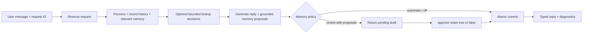

# Build a companion with one call

`CompanionBrain` owns the turn workflow. `Engine` and `Runtime` remain available for
advanced integration. Use MCP when an existing host writes the response; use this
SDK when your app wants Engine to call the model and save the result.

See [media, memory and provider configuration](sdk-capabilities.md) for the three-layer
configuration design, all new options and multimodal examples.

## First conversation

```python
import asyncio
from companion_engine import CompanionBrain, Settings

async def main():
    async with CompanionBrain(
        storage="./output/my-app/brain.sqlite3",
        user_id="alice",
        settings=Settings.from_env(),
    ) as brain:
        if not brain.characters():
            brain.create_character(
                character_id="mika", name="Mika",
                persona="Direct, playful, caring without empty reassurance.",
            )
        reply = await brain.chat(
            "mika", "Please remember I prefer tea.", request_id="my-app-message-1",
        )
        print(reply.text)
        print(reply.committed, reply.memory_ids)

asyncio.run(main())
```

Reopen the same path **and user_id** to continue. Each user's characters are private
to that namespace. IDs are not credentials: your app must authenticate the caller.
Use one brain instance per user for its lifetime; do not construct it per message.
For a synchronous application use `with CompanionBrain(...)` and `chat_sync(...)`.

To repeat the opt-in real provider check with two synthetic turns:

```bash
python examples/live_smoke.py --output ./output/my-live-smoke.json
```

This uses your configured provider and may incur charges. It verifies save, restart,
recall with recent history disabled, and exact replay with the provider unconfigured.
It preserves a private trace at the requested new output path and never overwrites a run.

## Configuration

```python
from companion_engine import BrainConfig, CompanionBrain, Settings

brain = CompanionBrain(
    storage="./output/brain.sqlite3",
    user_id="alice",
    settings=Settings(
        base_url="http://localhost:8000/v1", model="your-served-model",
        max_output_tokens=4096, timeout_seconds=45, temperature=0.7,
        reader_max_steps=1,
    ),
    config=BrainConfig(
        recent_turns=8, context_chars=48000,
        reply_instructions="Reply in natural English. Keep ordinary chat to 1–3 sentences.",
        capture_context=False,
    ),
)
# Call brain.close() when finished, or use a context manager.
```

| Configuration | Default | Meaning |
| --- | --- | --- |
| `Settings.base_url`, `model`, `api_key` | Empty | Your Chat Completions-compatible provider; endpoint must support JSON object output |
| `max_output_tokens` | 2048 | Whole JSON completion ceiling, including metadata and potentially provider reasoning; not the visible reply length |
| `temperature` | `None` | Omit from request, allowing provider default; accepted values depend on provider |
| `timeout_seconds` | 60 | HTTP timeout per provider operation, not a whole-conversation deadline |
| `reader_enabled`, `reader_max_steps` | `True`, 2 | Up to two extra planning calls; 0 skips planning but still retrieves initial context |
| `BrainConfig.recent_turns` | 10 | Maximum recent committed user/assistant pairs; these are complete exchanges, not messages |
| `recent_chars` | 12000 | Maximum serialized recent-pair payload, trimmed oldest first |
| `memory` | `MemoryConfig()` | Read switch, per-lane limits and 16000-character memory budget; see capability guide |
| `context_chars` | 48000 | Serialized context budget; schema/system overhead is additional, not a token estimate |
| `reply_instructions` | Conversational, brief soft targets | Application guidance layered under core grounding/boundary rules; empty string disables this addition |
| `capture_context` | `False` | Save exact final `TurnContext` data and return it for debugging; contains private content |
| `automation` | Background memory maintenance enabled | Configured indexing, semantic retrieval, reconciliation and summaries; existing explicit policies are preserved |
| `start_worker` | `True` | Service existing explicitly enabled automation policies while brain is open |

Character configuration is separate: persona, automatic/review/off memory, fictional
relationship simulation and romance opt-in, timezone. `update_character(CharacterSpec)`
also updates core persona, voice ID and appearance; these can be passed directly to `create_character`. Existing character settings and
automation policies are preserved on reopen. Creating an existing ID raises `Conflict`.

`Settings()` does not load any credentials. `Settings.from_env()` deliberately loads
saved provider settings plus `COMPANION_*` overrides; no dotenv file is sourced for you.
The built-in provider accepts HTTPS and loopback HTTP, and does not retry requests.
For a different API, inject a `Provider` implementing `complete(TurnContext) -> Completion`.
It must return JSON matching `CommitRequest`; it owns its timeouts and secrets.
An optional `structured(instructions, data)` method enables the lookup controller.

## What chat does



Memory retains source-backed facts, contextual raw/note vectors, episodes and a structured
core notebook. Fact proposals and attunement share the reply call. New SDK characters enable
provider-configured indexing, semantic retrieval, background reconciliation and summaries;
these add model calls while the worker is active. Configure an embedding provider for vectors.
`summary_base_url/model/key` optionally select a separate writer; otherwise the reply provider
is used, with `memory_max_output_tokens` (8192 by default). Explicit existing off policies stay
off. Set `automation=MemoryAutomation()` for an intentionally manual setup. Host summaries
require an active MCP host and are not a standalone writer. See [memory architecture,
defaults and migration](memory-parity.md) and [maintenance](memory-automation.md).

## Inspect the result

`ChatReply` includes:

- `text`, `turn_id`, `request_id`, `character_id`.
- `committed`, `needs_review`, `replayed` and the IDs of saved memories.
- `proposed_memories` and `proposed_corrections`: original model proposals, even if later declined.
- `generation`: model, retrieval mode, delivered memory/evidence/document IDs,
  recent history count, context size and generation duration. This is what was supplied,
  not proof the model relied on each item.
- `usage`: chat/reader/vision token reports across this turn, including missing-report count.
  Unknown cost is `None`. Embeddings/maintenance and explicit media generation have separate
  operation receipts. Vision also has an operation receipt; do not count it twice.
- `elapsed_seconds`: elapsed time for this invocation; replay can be fast while
  `generation.elapsed_seconds` retains the original generation duration.
- `warnings` and, only when requested, `context`. This records the final data envelope,
  not a hidden reasoning trace or a verbatim HTTP request with credentials.

`brain.memories()`, `history()`, `pending()` and `receipts()` support inspection.
`remember(...)` accepts an explicit application-approved `MemoryDraft`; `delete_memory(...)`
requires the inspected revision. Deleting a fact does not erase its original conversation.
Memory policy `off` prevents new durable facts, **but chat history is still stored**.
Relationship numbers are fictional expression controls, not psychological measurements.

## Review, errors and retries

For `memory_policy="review"`, show `reply.text` and proposals, then:

```python
reply = brain.approve("mika", reply.turn_id, retain=True)  # or False
```

Until approval, neither the reply nor its memory changes are committed and the next
turn is blocked. Declining still commits the conversation without those memory changes.

Supply your app's stable message ID as `request_id`. Omission generates an ID, convenient
for a terminal but insufficient for retries after a client disconnect. Same ID + same
message and image content hashes/detail reuses completed work; different content raises `Conflict`. Successful replay
does not require provider credentials. No fallback model or automatic paid retry runs.

`ChatFailed` exposes the request ID, pending turn ID, error type, and an already-generated
`reply_text` if saving failed. If a generation receipt succeeded, repeating the same request
reuses the draft and retries its commit. If a provider outcome is uncertain, inspect
`receipts()` and explicitly `discard_pending(character_id, turn_id)` before a new request
ID. That can incur another provider charge. Do not discard an actively running request.

Calls on one instance serialize; independent instances/processes use SQLite reservations.
Async calls run the synchronous Runtime in a worker thread. Canceling the async waiter
does not stop an in-flight provider call. Closing the brain waits for its in-flight work.
This is local orchestration, not a distributed task queue or streaming API.
