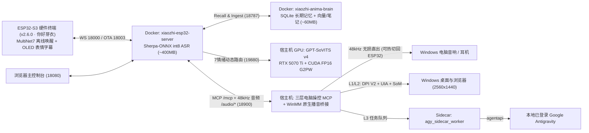

# 小智 ESP32-S3 · 雷电芽衣语音助手与三层电脑操控系统 · 项目交接与运维手册

> [!IMPORTANT]
> **项目根目录**：[xiaozhi-server](file:///e:/故事/1/xiaozhi-server)（外部显卡语音引擎目录：[gpt-sovits-studio](file:///e:/故事/1/gpt-sovits-studio)）
> **GitHub 开源仓库**：https://github.com/zou172866/xiaozhi-windows-pc-mcp
> **版本基线与回滚标签**：内存优化前基线标签 `v-pre-mem-opt`（`27263d7`）；当前主线含四层内存治理 + 48kHz 电脑音响直通 + `v2.6.0` 离线唤醒词“你好芽衣”与打断词“听我说” + 控制台字数与亲密度免重启热调 + Anima Brain 长期记忆自愈修复
> **AI 接手必读红线**：新会话或新 Agent 接手修改本目录前，务必先读 [AGENTS.md](file:///e:/故事/1/xiaozhi-server/AGENTS.md)、工作区运维技能 [xiaozhi-esp32-ops/SKILL.md](file:///e:/故事/1/xiaozhi-server/.agents/skills/xiaozhi-esp32-ops/SKILL.md) 与跨项目桌面操控技能 [SKILL.md](file:///C:/Users/Administrator/.gemini/config/skills/windows-pc-mcp-automation/SKILL.md)。

---

## 一、系统全景架构与端口矩阵



### 全链路端口分配表（统一 `>15000` 高位端口，彻底避开 Windows Hyper-V 动态端口征用）

| 宿主机端口 | 归属进程 / 容器 | 作用说明 | 访问或日志位置 |
| :--- | :--- | :--- | :--- |
| **`18000`** | Docker `xiaozhi-esp32-server` | ESP32 实时语音双向 WebSocket 主通道（容器内 `8000`） | `ws://192.168.31.200:18000/xiaozhi/v1/` |
| **`18003`** | Docker `xiaozhi-esp32-server` | ESP32 开机 OTA 握手下发配置接口（容器内 `8003`） | `http://192.168.31.200:18003/xiaozhi/ota/` |
| **`18080`** | Docker `xiaozhi-esp32-server` | **主可视化控制台**（三挡操控锁、**电脑音响/ESP32 热切与增益**、**日常/故事字数热调**、**亲密度与浪漫尺度热调**、模型切换、7 情绪试听、实时对话） | http://localhost:18080 |
| **`18787`** | Docker `xiaozhi-anima-brain` | **Companion Studio** 长期记忆库、人物笔记与情绪余温面板 | [打开Companion Studio控制台.bat](file:///e:/故事/1/xiaozhi-server/打开Companion%20Studio控制台.bat) |
| **`18900`** | 宿主机 `pc-mcp\.venv` Python | Windows 三层电脑操控 MCP（`/mcp`）+ **48kHz WinMM 电脑音响直通接口**（`/audio/*`） | `data\pc_mcp_18900.log` |
| **`19880`** | 宿主机 `gpt-sovits-studio\.venv` | `RTX 5070 Ti` 雷电芽衣 V4 / 台湾小智本地语音合成 API（含 60s 闲置自动冷页回收） | `data\gsv_19880.log` |

---

## 二、硬件终端与固件交接记录（ESP32-S3）

- **固件版本与自定义唤醒词**：`bread-compact-wifi v2.6.0`（`0.91" SSD1306 128×32`、`partitions/v2/16m.csv`，16MB Flash + 8MB PSRAM，USB 串口当前为 `COM4`）
  - **离线自定义唤醒词与打断词**：`0x800000`（8MB `assets` 分区）搭载乐鑫原厂 `esp-sr 2.4.7` 的 **`MultiNet7 (mn7_cn)` + `fst`**，并行配置两条自定义命令词：`ni hao ya yi` → **`你好芽衣`**、`ting wo shuo` → **`听我说`**（`threshold: 0.2`，`duration: 3000ms`）；播报中喊“听我说”立即触发 `abort`（~11ms 截断电脑音响）并直进聆听；如需调整灵敏度或增减词条，只需重打包并单刷 `0x800000` 的 `assets.bin`（~10 秒，不影响主固件与 Wi-Fi）；
  - **芽衣专属唤醒秒回语与打断词直通聆听**：服务端 [data/.config.yaml](file:///e:/故事/1/xiaozhi-server/data/.config.yaml) 已配置 `wakeup_words`（含 `你好芽衣` 及常见同音词）与 `interrupt_words`（`听我说`），[mei_emotion_router.py](file:///e:/故事/1/xiaozhi-server/data/mei_emotion_router.py) 对唤醒词自动播放芽衣温柔短句（默认兜底音频 `data/voices/raiden_mei/wakeup_mei_default.wav`），对打断词跳过寒暄与 2 秒 VAD 屏蔽直接静音开麦。
- **已验证焊接引脚定义**：
  - **INMP441 数字麦克风**：`WS = GPIO 4`、`SCK = GPIO 5`、`SD = GPIO 6`
  - **MAX98357A 数字功放**：`DIN = GPIO 7`、`BCLK = GPIO 15`、`LRC = GPIO 16`（若未来升级外接板载喇叭，选用 4Ω 3W 腔体喇叭并在 `VIN`/`GND` 并 `470~1000µF` 电容；**严禁将 BTL 喇叭口直插电脑 Line-In 或有源音箱**）
  - **SSD1306 OLED 显示屏**：`SDA = GPIO 41`、`SCL = GPIO 42`（0.91 寸 128×32）
- **NVS 分区与回退方法**：
  - 设备 NVS `wifi` 命名空间（偏移 `0x9000`）已原位保留本机局域网 `http://192.168.31.200:18003/xiaozhi/ota/` 与家庭 Wi-Fi 凭证（升级前后免重配网）。
  - **本地备份文件**（均已被 [.gitignore](file:///e:/故事/1/xiaozhi-server/.gitignore) `*.bin` 排除，严禁提交）：
    - `data/nvs_v194_local_backup.bin`：升级前含 Wi-Fi + 本地 `18003` OTA 的热备份；
    - `data/esp32_v194_boot_pt_nvs_backup.bin`：升级前 `0x0..0x10000` 引导与 v1 分区表备份；
    - `data/nvs_original_backup.bin`：出厂官方云端原始 NVS 备份。
  - **若宿主机局域网 IP 变化**：同步更新 [.config.yaml](file:///e:/故事/1/xiaozhi-server/data/.config.yaml) 第 10～11 行 IP 与 [docker-compose.yml](file:///e:/故事/1/xiaozhi-server/docker-compose.yml) 中 `ANIMA_LAN_IP`，并重刷 NVS `ota_url`。
  - **一键刷回官方小智服务器命令**：
    ```powershell
    esptool --chip esp32s3 --port COM4 write-flash 0x9000 "e:\故事\1\xiaozhi-server\data\nvs_original_backup.bin"
    ```

---

## 三、日常启停与运维快捷入口

所有 `.bat` 保持**纯 ASCII + CRLF**，底层委托给 UTF-8 BOM PowerShell 脚本，并通过 WMI `Win32_Process.Create`（`ShowWindow = 0`）无黑框静默运行：

1. **开机/日常一键静默启动**：双击 [启动或重启服务.bat](file:///e:/故事/1/xiaozhi-server/启动或重启服务.bat)（调用 [start_all.ps1](file:///e:/故事/1/xiaozhi-server/data/start_all.ps1)）
   - 自动按序拉起 Docker → `18900` MCP 与电脑音响桥接 → `19880` 显卡配音服务（注入 `GSV_IDLE_TRIM_SECONDS=60`）→ 双容器（冷启 ~2 秒）→ 预热并自动回收 `19880`/`18900` 冷内存页与 WSL2 文件缓存。
2. **打大型游戏/不用时彻底关停释放显存**：双击 [关闭小智服务.bat](file:///e:/故事/1/xiaozhi-server/关闭小智服务.bat)（调用 [stop_all.ps1](file:///e:/故事/1/xiaozhi-server/data/stop_all.ps1)）
   - 停止双容器并按 PID 精准停止 `18900`、`19880`（绝不误杀已打开的浏览器）。
3. **打开 `18080` 主控制台**：双击 [打开网页控制台.bat](file:///e:/故事/1/xiaozhi-server/打开网页控制台.bat)
4. **打开 `18787` 长期记忆面板**：双击 [打开Companion Studio控制台.bat](file:///e:/故事/1/xiaozhi-server/打开Companion%20Studio控制台.bat)
5. **实时查看运行日志**：双击 [查看实时日志.bat](file:///e:/故事/1/xiaozhi-server/查看实时日志.bat)

---

## 四、核心子系统交接清单与文件地图

### 1. 密钥安全、大模型与轻量化语音识别
- **核心文件**：[docker-compose.yml](file:///e:/故事/1/xiaozhi-server/docker-compose.yml)、[start_with_env.py](file:///e:/故事/1/xiaozhi-server/data/start_with_env.py)、[.config.yaml](file:///e:/故事/1/xiaozhi-server/data/.config.yaml)
- **密钥零落盘**：仅从 Windows 环境变量 `DEEPSEEK_API_KEY` 与 `GEMINI_API_KEY` 内存注入。
- **双模型热切**：默认 `DeepSeekLLM`（`deepseek-flash` V4.1 原生多模态视觉，国内低延迟），控制台保留一键切换 `GeminiOpenAI`（`gemini-3.5-flash-lite`）。
- **轻量 `SherpaASR`（SenseVoiceSmall int8 ONNX）**：
  - 默认 `selected_module.ASR: SherpaASR`，模型位于 `models/sherpa-onnx-sense-voice/`（`model.int8.onnx` 228 MB + `tokens.txt`），原 `models/SenseVoiceSmall/model.pt` 完整保留作回滚备份；
  - `start_with_env.py` 内置本地文件优先的 `modelscope` 懒加载守卫（避免无谓拖入 `+330 MB` PyTorch/scipy）、异步线程 `decode_stream` 与每 180 秒 `glibc malloc_trim(0)`；容器内存由 `3.54 GB` 降至 **`~385 MB`**，冷启由 `~15s` 缩短至 **`~2s`**，本地转写 `90~190 ms`。
- **防抢话 VAD**：`SileroVAD`（ONNX）静默阈值 `min_silence_duration_ms: 1100`、`threshold_low: 0.2`，自然换气不截断。

### 2. Windows 电脑音响 48kHz 原声直通系统（零硬件、免重启热切）
- **核心文件**：[pc_audio_router.py](file:///e:/故事/1/xiaozhi-server/data/pc_audio_router.py)、[audio_output_mode.json](file:///e:/故事/1/xiaozhi-server/data/audio_output_mode.json)、[pc_control_mcp.py](file:///e:/故事/1/xiaozhi-server/pc-mcp/pc_control_mcp.py)、[console_server.py](file:///e:/故事/1/xiaozhi-server/data/console_server.py)、[console.html](file:///e:/故事/1/xiaozhi-server/data/console.html)
- **工作机制**：
  - **宿主机端（复用 `18900`）**：基于 Windows 原生 `winmm.dll`（`waveOut`）实现零额外依赖的 48kHz 无损 PCM 顺序播放队列，提供 `GET /audio/status`、`POST /audio/play`、`POST /audio/stop`、`GET /audio/wait`，**独立于电脑操控安全挡**（关闭电脑操控时依然正常播报），自动跟随系统默认音箱/耳机并与桌面声音混音；
  - **容器侧精准锁步**：`pc_audio_router.py` 在 `mei_emotion_router` 之前拦截 `to_tts_stream` 获取原生 48kHz WAV（以及 EdgeTTS/唤醒词），向 ESP32 下发等长数字静音 Opus 帧占位以保持 `SPEAKING` 状态；在 `mei_emotion_router` 之后拦截 `send_tts_message`，在 `sentence_start` 毫秒级触发电脑播音并同步刷新 ESP32 OLED 字幕与表情，在 `stop` 阶段等待电脑音箱真正播完最后一毫秒再开放麦克风（防尾音回声误触）；
  - **瞬间打断与断线兜底**：按键打断（`handleAbortMessage`）实测 **`~11 ms`** 截断电脑出声；若 `18900` 离线自动无感回退 ESP32 本机喇叭；
  - **`18080` 控制台**：提供 **「ESP32 本机喇叭 / Windows 电脑音响」免重启热切换**、`20%～150%` 增益滑块与 **「电脑音响试播」** 按钮（当前默认：`pc`、`100%`）。

### 3. 三层 Windows 电脑操控与高分屏精准定位
- **核心文件**：[pc_control_mcp.py](file:///e:/故事/1/xiaozhi-server/pc-mcp/pc_control_mcp.py)、[agy_sidecar_worker.py](file:///e:/故事/1/xiaozhi-server/pc-mcp/agy_sidecar_worker.py)、[.mcp_server_settings.json](file:///e:/故事/1/xiaozhi-server/data/.mcp_server_settings.json)
- **三挡安全锁**（`data/pc_control_mode.json`，`18080` 秒切免重启）：`关闭` / `日常游戏安全挡（禁键鼠防误触）` / `全权操控挡`。
- **关键工程实现**：
  - 64 位 Win32 `_force_foreground_window()` 破除后台焦点锁，语音开网页/软件直接弹出置顶；
  - `SetProcessDpiAwarenessContext(-4)` 锁死 `2560×1440 @ 200% DPI` 1:1 物理像素，三阶点击「18 层 UIA 直点 → Set-of-Mark 红框数字角标 + `0~1000` 归一化框 → `768×512` 局部放大精修」（落点核验图见 `data/last_som_grounding.jpg`）；
  - L3 反重力异步派单：通过官方 Sidecar `Xiaozhi Bridge` 调度 `agentapi` 在本地 Antigravity 自动开会话执行复杂工程任务。

### 4. 雷电芽衣 7 情绪动态语音与宿主机 GPU 内存治理
- **核心文件**：[mei_emotion_router.py](file:///e:/故事/1/xiaozhi-server/data/mei_emotion_router.py)、[mei_emotions.json](file:///e:/故事/1/xiaozhi-server/data/voices/raiden_mei/mei_emotions.json)、[onnx_api.py](file:///e:/故事/1/gpt-sovits-studio/GPT_SoVITS/text/g2pw/onnx_api.py)、[TTS.py](file:///e:/故事/1/gpt-sovits-studio/GPT_SoVITS/TTS_infer_pack/TTS.py)、[api_v2.py](file:///e:/故事/1/gpt-sovits-studio/api_v2.py)
- **7 情绪原声路由**：`calm / gentle / happy / playful / shy / serious / tender`，流式剥离隐藏标签、取消首句短逗号碎切（`cut0`）、按播放进度同步 OLED 表情、控制台试听其他音色后自动恢复芽衣 V4 权重。
- **宿主机 `19880` GPU 内存瘦身（本地 `gpt-sovits-studio` 改动，备份补丁见 [pre_mem_opt_backup.patch](file:///e:/故事/1/gpt-sovits-studio/pre_mem_opt_backup.patch)）**：
  - **CUDA FP16 G2PW**：`G2PWTorchConverter` 直接加载 `pretrained_models/g2pw-chinese/pytorch_model.bin`（FP16 303 MB 显存，**0 MB CPU 内存**，140/140 多音字 100% 一致，耗时 `88ms → 23ms`），彻底移除默认 `onnxruntime` 导入与 CUDA 13 DLL 报错（需回退 CPU ONNX 可设环境变量 `GSV_G2PW_BACKEND=onnx`）；
  - **无膨胀加载与幂等切换**：`BERT` 改用 `torch_dtype=torch.float16, low_cpu_mem_usage=True`，`T2S/VITS` 同路径跳过重复重载并及时清理旧模型与中间字典；
  - **自动冷页回收**：`GSV_IDLE_TRIM_SECONDS=60` 触发对话空闲 60s 或切音色权重后自动 `gc.collect()` + `torch.cuda.empty_cache()` + `EmptyWorkingSet`，闲置 WS 稳定压至 **`~10–20 MB`**。

### 5. 长期记忆同步、字数热调、免 Key 天气与整机内存现状
- **长期记忆同步与亲密度热调（[anima_memory_provider.py](file:///e:/故事/1/xiaozhi-server/data/anima_memory_provider.py) / [xiaozhi_anima_service.py](file:///e:/故事/1/xiaozhi-server/anima-brain/xiaozhi_anima_service.py)）**：`data/anima/brain.sqlite3`，召回自动去重人设段、标注记忆日期并防旧待办机械复读，`18080` 保存人设自动同步至 `18787`；提供 `GET/POST /xiaozhi/relationship` 与 `18080` 控制台 **「亲密度与关系热度」** 卡片（克制助手 / 温柔知己 / 亲密依恋预设 + Romance 开关 + 四轴百分比滑块 + 中文互动尺度实时注入，下一句免重启生效）；内置 Gemini `/embeddings` `index` 兼容补丁与超时 `review` 锁自愈守护。
- **回复字数与讲故事篇幅热调（[reply_length_router.py](file:///e:/故事/1/xiaozhi-server/data/reply_length_router.py)）**：`18080` 控制台提供 4 档一键预设与日常/故事双滑块（`data/reply_length_config.json`），拖动即刻免重启生效并动态扩展 `max_tokens`。
- **免 Key 天气（[nmc_weather_patch.py](file:///e:/故事/1/xiaozhi-server/data/nmc_weather_patch.py)）**：直连中央气象台 `nmc.cn`（本地缓存近 2800 站点，默认 `长沙`，永不过期）。
- **内存治理实测成果（[.wslconfig](file:///C:/Users/Administrator/.wslconfig) 保留 `memory=7GB` + `autoMemoryReclaim=gradual`）**：
  - 宿主机总物理内存占用由 **`22.84 GB (72.2%)`** 降至 **`15.35 GB (48.5%)`**（立省 **~7.5 GB**）；
  - `xiaozhi-esp32-server` 由 `3.54 GB` 降至 **`~385 MB`**，`xiaozhi-anima-brain` 仅 **`~55–74 MB`**，`19880` 闲置仅 **`~10–20 MB`**，RTX 5070 Ti 显存总占用 **`~3.85 GB / 16.3 GB`**。
  - 备注：Docker Desktop 默认开启与 `Ubuntu` 的 WSL 集成会导致 `Ubuntu` 随 Docker 自动常驻（~300 MB）；如平时不在 Ubuntu 内用 `docker` 命令，可在 **Docker Desktop → Settings → Resources → WSL Integration** 取消勾选默认发行版集成并重启即可再省 ~300 MB。

---

## 五、常见故障速查与回滚指南

| 故障现象 / 需求 | 排查点 | 解决动作 |
| :--- | :--- | :--- |
| **电脑音响不出声或声音太小/太大** | http://localhost:18080 「语音播报输出端」卡片 | 确认选为 **Windows 电脑音响**、桥接状态为**已在线**，拖动增益滑块并点 **「电脑音响试播」**；若显示离线，双击 [启动或重启服务.bat](file:///e:/故事/1/xiaozhi-server/启动或重启服务.bat) 重拉 `18900` |
| **想临时切回 ESP32 板载小喇叭** | http://localhost:18080 「语音播报输出端」卡片 | 点选 **ESP32 本机喇叭**，下一句话即刻免重启生效 |
| **小智有字幕但完全不出声** | `19880` 端口 / `data\gsv_19880.log` | 双击 [启动或重启服务.bat](file:///e:/故事/1/xiaozhi-server/启动或重启服务.bat) 自动重拉 `19880` 显卡配音服务 |
| **提示安全挡锁定无法点击屏幕** | `18080` 控制台顶部挡位 | 切换为 **【全权操控挡】**（秒生效） |
| **核验鼠标视觉点击落点** | `data\last_som_grounding.jpg` | 查看绿十字准星落点与红底编号框 |
| **L3 反重力派单显示离线** | Antigravity 设置 → Sidecars | 确认 `Xiaozhi Bridge` 开启并检查 `data\agy_tasks\worker_heartbeat.json` |
| **全链路 21 项自动化体检** | 容器内回归测试套件 | 运行 `docker exec xiaozhi-esp32-server python3 /opt/xiaozhi-esp32-server/data/test_mei_emotion_and_prosody.py` |
| **需要回滚到内存优化前版本** | GitHub 标签 / 本地补丁 | `xiaozhi-server` 执行 `git checkout v-pre-mem-opt`（或仅把 `.config.yaml` 中 `ASR` 改回 `FunASR`）；`gpt-sovits-studio` 设 `GSV_G2PW_BACKEND=onnx` 或按 `pre_mem_opt_backup.patch` 还原 |
