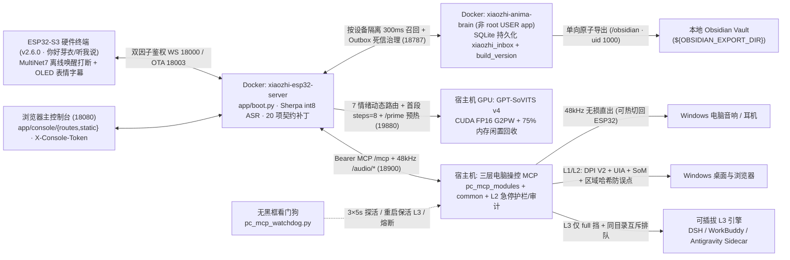

# 小智 ESP32-S3 · 雷电芽衣语音助手与三层电脑操控系统 · 项目交接与运维手册

> [!IMPORTANT]
> **GitHub 开源仓库**：https://github.com/zou172866/xiaozhi-windows-pc-mcp  
> **红线与回归清单**：[AGENTS.md](AGENTS.md)（仅红线 + 防回归清单 + 必跑命令）  
> **自动生成补丁契约总表**：[docs/patches.md](docs/patches.md)（由 `app/patches/registry.py` 生成，CI 强校验）  
> **版本里程碑**：内存优化前基线 `v-pre-mem-opt`（`27263d7`）→ 便携化基线 `v1.0-personal-mei`（`a936500`）→ 跨机解耦 `e22956a` → P0～P2 巩固 `9711973` → 综合改进 Batch 1–2 `eef8f6e` → Batch 3 `b8babde` → Batch 4 工程化全量落地。  
> **当前全链路验证基线**：**211 项三层自动化测试全绿**（`unit` 195 项 + `contract` 7 项 + `live` 9 项），20/20 启动补丁契约全通过且 1:1 匹配 `PATCH_CATALOG`。

---

## 一、系统全景架构、端口矩阵与实测资源基线



### 1. 全链路端口分配表（统一 `>15000` 高位端口）

| 宿主机端口 | 绑定范围 | 归属进程 / 容器 | 作用说明 | 日志与健康入口 |
| :--- | :--- | :--- | :--- | :--- |
| **`18000`** | `0.0.0.0` | Docker `xiaozhi-esp32-server` | ESP32 双向 WebSocket（容器 `8000`），强制 MAC 白名单 + HMAC Bearer Token | `ws://${HOST_LAN_IP}:18000/xiaozhi/v1/` |
| **`18003`** | `0.0.0.0` | Docker `xiaozhi-esp32-server` | ESP32 OTA（`/xiaozhi/ota/`）与 Vision（`/mcp/vision/explain`），强制白名单与令牌 | `http://${HOST_LAN_IP}:18003/xiaozhi/ota/` |
| **`18080`** | `127.0.0.1` | Docker `xiaozhi-esp32-server` | 主可视化控制台（挡位、L3、音响、字数、亲密度、投机 VAD、ASR 纠错、Obsidian、Outbox 重放） | `http://127.0.0.1:18080/api/health` |
| **`18787`** | `127.0.0.1` | Docker `xiaozhi-anima-brain` | Companion Studio + 长期记忆引擎 + Obsidian 单向导出（非 root `USER app`） | `http://127.0.0.1:18787/health`、`/xiaozhi/health` |
| **`18900`** | `127.0.0.1` | 宿主机 `pc-mcp\.venv` Python | 三层操控 MCP（`/mcp`）+ 48kHz WinMM 播音（`/audio/*`）+ `/mode` + `/l3/*` | `logs/pc_mcp_18900.log`、`pc-mcp/state/watchdog_state.json` |
| **`19880`** | `127.0.0.1` | 宿主机 `gpt-sovits-studio\.venv` | 可选本地 GPU `GPT-SoVITS v4` API（无独显自动跳过走 `EdgeTTS`） | `logs/gsv_19880.log`（5MB×3 轮转） |

### 2. 实测内存与延迟基线

| 指标 | 优化前基线 | 当前实测值 | 说明 |
| :--- | :--- | :--- | :--- |
| `xiaozhi-esp32-server` 常驻内存 | `~3.54 GB`（FunASR + PyTorch） | **`~412–416 MiB`**（`docker stats`；`VmRSS ~457 MiB`，`RssAnon ~392 MiB`） | Sherpa-ONNX int8 + `modelscope` 懒加载 + glibc `MALLOC_ARENA_MAX=2` + 每轮空闲 25s `gc`/`malloc_trim(0)`；WSL2 渐进冷页回收后可进一步降至 ~200–350 MiB |
| `xiaozhi-anima-brain` 常驻内存 | `~90 MiB` | **`~67–84 MiB`**（`docker stats`；`VmRSS ~70 MiB`） | Python 3.12-slim 非 root `USER app`，内置 Obsidian 单向导出 |
| 投机性 VAD 尾延迟（F-1） | 固定 `1140ms` 等待 | **`660ms`**（完整句平均省 **`480ms`**，34 条句中换气 **`0/34` 误截断**） | 保留 `1100ms` 硬上限，可经 `18080` 一键热关回退纯 `1100ms` |
| 控制台 `/api/state` 响应耗时 | 同步探活数百毫秒 | **`~10ms`** | 后台 3s 探活守护线程 + 2 次失败防抖 + 增量日志游标 |

---

## 二、硬件终端与固件交接记录（ESP32-S3）

- **固件规格**：`bread-compact-wifi v2.6.0`（`0.91" SSD1306 128×32`、`partitions/v2/16m.csv`，16MB Flash + 8MB PSRAM）。
- **离线唤醒词与打断词**：`0x800000` `assets` 分区搭载原厂 `esp-sr 2.4.7` `MultiNet7 (mn7_cn)` + `fst`，并行两条命令词：`ni hao ya yi`（`你好芽衣`）与 `ting wo shuo`（`听我说`，`threshold: 0.2`）。播报中喊「听我说」立即触发 `abort`（~11ms 截断电脑音响）并零寒暄直进聆听；唤醒问候语已标记 `_standalone_assistant`，不污染 Anima 记忆。
- **已验证焊接引脚**：
  - INMP441 麦克风：`WS=GPIO4`、`SCK=GPIO5`、`SD=GPIO6`
  - MAX98357A 功放：`DIN=GPIO7`、`BCLK=GPIO15`、`LRC=GPIO16`（严禁将 BTL 喇叭口直插电脑 Line-In 或有源音箱）
  - SSD1306 OLED：`SDA=GPIO41`、`SCL=GPIO42`
- **鉴权与 NVS 备份**：
  - 设备 NVS `wifi` 命名空间（`0x9000`）指向 `http://${HOST_LAN_IP}:18003/xiaozhi/ota/`；首次开启或更换 `ESP32_AUTH_KEY` 后需对 ESP32 重新上电/按 RST 键，令其经 OTA 拉取最新签名 `websocket.token`。
  - 真实 MAC（`ESP32_ALLOWED_DEVICES`）与签名密钥（`ESP32_AUTH_KEY`）仅保存在被 `.gitignore` 隔离的 `.env`；NVS 与引导区备份保存在被忽略的 `backups/` 目录（刷机前必先备份）。

---

## 三、日常启停、镜像重建与开发模式

1. **开机 / 日常一键启动或重启**：双击 `启动或重启服务.bat`（委托 `data/start_all.ps1`）
   - 自动校验 `.env`、生成独立最小权限 `secrets/anima_tokens.env` 与 `secrets/pc_mcp_tokens.env`、写入当前 `git short sha` 到 `ANIMA_BUILD_VERSION` 与 `XIAOZHI_BUILD_VERSION`（若检测到 `anima-brain/` 源码变更或镜像版本落后会自动触发高速缓存重建）；
   - 拉起宿主机 `18900` MCP 并带 Bearer Token 探活 `/audio/status`，验活后拉起无黑框看门狗 `pc-mcp/pc_mcp_watchdog.py`；
   - 按需拉起 `19880` GPU 引擎（无独显自动跳过）并调用 `POST /prime` 预热 7 情绪缓存；
   - 执行非 root `uid 1000` 平滑权限检查（若检测到旧版 root 遗留文件阻塞 `/data/anima` 或 `/obsidian`，自动执行一次性 `chown -R 1000:1000`）后 `docker compose up -d`。
2. **彻底关停**：双击 `关闭小智服务.bat`（委托 `data/stop_all.ps1`）
   - 优雅停止双容器（`anima-brain` 享有 `25s` 排空期刷盘 inbox 与 Obsidian）→ 停止看门狗并按 `create_time()` 定向清理 L3 子进程树 → 按单 PID 停止 `18900`/`19880`（绝不 `taskkill /T`）→ 清理 `agy_sidecar_worker.py` → 无其他容器时自动退出 Docker Desktop。
3. **跨机首次初始化**：双击 `一键初始化配置.bat`（委托 `data/init_setup.ps1`），支持增量合并 `.env`、自动探测本机 Obsidian Vault 列表与无独显默认配置。
4. **修改 `anima-brain/` 源码后的部署与开发模式（H-2 / H-3 / H-4）**：
   - 生产模式不使用单文件 `:ro` 源码挂载；修改 `anima-brain/` 后执行：
     ```powershell
     $env:ANIMA_BUILD_VERSION = (git rev-parse --short HEAD)
     docker compose build anima-brain
     docker compose up -d anima-brain
     ```
   - 镜像使用锁定 digest 的 `node:22-slim@sha256:...` 与 `python:3.12-slim@sha256:...`、Py3.12 `anima-brain/constraints.txt`、构建期 `ui/build.mjs` 编译静态面板、非可编辑 wheel 安装与非 root `USER app`；部署后可通过 `GET http://127.0.0.1:18787/health` 核对 `build_version` 与 `obsidian.writable: true`。
   - 频繁调试 `anima-brain/` 时，可将 `docker-compose.override.yml.example` 复制为未跟踪的 `docker-compose.override.yml` 实现整目录挂载（调试完删除并重建镜像）。

---

## 四、核心子系统现状与 Batch 1–4 演进地图

### 1. 权限边界与安全加固（A-1～A-5 / C-1～C-3）
- **最小权限目录与令牌分离（A-1）**：`app/`、`config/`、`voices/` 只读挂入主容器；`secrets/`、`backups/`、`logs/`、`models/gsv_weights/` 不入容器；`secrets/anima_tokens.env` 供双容器，`secrets/pc_mcp_tokens.env` 仅注入主容器（live 回归强制校验 `anima-brain` 环境内无 `PC_MCP_TOKEN`）。
- **控制面与 L2/L3 护栏（A-2/3/4/5）**：操控挡位唯一权威移至宿主机 `pc-mcp/state/pc_control_mode.json`；`18080` 启动生成随机 `X-Console-Token` 拦截 CSRF/SSRF，内部 `Host: xiaozhi-esp32-server` 仅放行只读 `/api/health` 与 `/api/state`；L2 具备 `FAILSAFE=True`、`Ctrl+Alt+Pause/Break` 双虚拟键急停、高危热键子集拦截、资源管理器地址栏/搜索框（含 Win11 XAML Islands UIA）与终端/运行框拒输、剪贴板输入后强制还原/清空，审计日志 5MB×3 轮转。
- **ESP32 双因子鉴权与安全启动门禁（C-1/2/3）**：OTA / WebSocket / Vision 全部强制 MAC 白名单 + HMAC Bearer Token；5 项 `security` 补丁 fail-closed 拒绝不安全启动，15 项 `experience` 补丁按签名与提示词锚点 fail-soft 降级（详见 [docs/patches.md](docs/patches.md)）。

### 2. 记忆零丢轮与 Obsidian 单向同步（B-1～B-6 / C-6）
- **服务端持久化收件箱（B-1）**：`anima-brain/xiaozhi_anima_service.py` 在 `brain.sqlite3` 维护 `xiaozhi_inbox` 表，事务 `INSERT OR IGNORE` 落盘后再返 HTTP 200，启动与运行期自动恢复 `pending`/超时 `processing` 行；提供 `anima-brain/scripts/rollback_inbox.py` 紧急回滚脚本与 `/xiaozhi/health` 队列/死信指标；同时保留定时全量 WAL-safe 备份与完整性校验（B-2）。
- **客户端发件箱死信与重放（B-3/4/5）**：`app/anima_memory_provider.py` 本地 SQLite Outbox 防同 `request_id` 冲突覆盖，HTTP 4xx 或指数退避超 8 次转 `dead`，超过 14 天自动 TTL 清理，并在 `18080` 提供统计与「重放 dead」一键恢复。
- **按设备隔离召回与 Obsidian 导出（C-6 / B-6）**：召回缓存与 `mei_emotion_router` 情绪上下文按 `device_id` 隔离，温缓存命中仍保留 300ms 同步召回预算（防慢一轮）；Obsidian 单向原子导出经 `engine._lock` 读库并生成 `总览.md`、`对话/YYYY/MM/YYYY-MM-DD.md` 与 `记忆/` 双链笔记（`^t-<8位>` 块 ID + 凭据脱敏）。

### 3. 语音管线、延迟、内存与控制台体验（C-4/5/7/8 / D-1..7 / F-1..4 / G-1..4）
- **核心管线异步化（C-4/5/7/8）**：唤醒缓存刷新使用不可变快照并仅在 GSV 空闲时经异步锁执行；阻塞 HTTP/写盘经 `asyncio.to_thread` 卸载；`AudioRateController.queue_empty_event` 有界防死等；对话记忆提交改用事件循环 `call_later` + 快照；`nmc_weather` 复用 `httpx.AsyncClient` 与 `5min→1h` 指数退避。
- **延迟与识别升级（F-1/2/3 / G-1/2/3/4）**：`vad_speculative` 投机性句末早判（~550ms 预解码 + 1100ms 硬上限 + 热开关）；`turn_context_router` 分离静态 `system` 与动态 `<turn_context>` 提升前缀缓存命中率并遥测 TTFT；GSV 启动 `/prime` 预热 7 情绪与短参考暖机、唤醒异步预热；独立 1 线程 `asr` 执行器 + `asr_corrections` 热更新同音纠错表 + 每轮空闲 25s `gc.collect()`/`malloc_trim(0)` + 75% 内存阈值条件性 `EmptyWorkingSet`。
- **18080 控制台工程化（D-1..7 / H-1）**：拆分 `app/console/{server,shared}.py`、`routes/{gsv,logs,l3,anima,config,state}.py` 与独立静态资源 `static/{index.html,app.css,app.js}`；聊天记录 2s 合并异步刷盘、`.config.yaml` 写锁与 400 白名单校验、256KB 单次日志上限 + 5s 游标节流 + 切后台暂停轮询、`_send_json` 统一脱敏、限频异常日志与显式 `voice_id` 持久化。

### 4. 宿主机 MCP 与全仓库工程化（E-1..4 / H-1..9 / I-1）
- **宿主机可靠性（E-1..4 / H-5/6/7/9）**：看门狗 3×5s 探活、重启仅停 MCP 保活运行中 L3 子进程、10 分钟 3 次熔断告警；L3 同工作目录单任务互斥与排队/取消；视觉定位截图后释放 `_gui_lock` 并在点击前比对目标区域哈希；Sidecar 独立心跳线程与防 `-` 参数注入；shim 解包/原子写/dotenv/任务管理统一抽入 `pc-mcp/common/`（补齐 Sidecar Node `.cmd` shim 分支与 `create_time` 校验）；开始菜单敏感工具黑名单与 mtime 缓存；`pc-mcp/requirements.in` → 45 包 SHA-256 哈希锁 `requirements.txt`。
- **大文件拆分与离线测试/CI（H-1 / H-8 / I-1）**：`start_with_env.py` / `mei_emotion_router.py` / `console_server.py` 拆分为无循环依赖的 `app/boot.py`、`app/patches/`、`app/patches/emotion/`、`app/console/`（保留透明兼容门面与零导入副作用）；所有容器测试迁至 `tests/container/`，`scripts/run_tests.py` 的 `unit` 与 `contract` 层使用临时 `docker run --rm` 彻底解耦运行中容器；新增 4-job `.github/workflows/ci.yml` 与 `scripts/generate_patches_doc.py` 自动维护 [docs/patches.md](docs/patches.md)。

---

## 五、常见故障速查与三层自动化体检命令

| 故障现象 | 排查位置 | 解决动作 |
| :--- | :--- | :--- |
| **开启鉴权后 ESP32 连不上（`18000` 秒断）** | `docker logs xiaozhi-esp32-server` 搜 `[esp32_auth]` | 对 ESP32 断电重启或按 RST 键触发 OTA 拉取最新签名 `token`；核对 `.env` 中 `ESP32_ALLOWED_DEVICES` 与 `HOST_LAN_IP` |
| **主容器启动直接退出（Exit Code 2）** | `docker logs xiaozhi-esp32-server` 搜 `[SECURITY BOOT GATE]` | 上游镜像签名变化导致 `security` 补丁契约失败；运行 `python scripts/run_tests.py --layer contract` 定位并修复（应急排障仅可临时设 `XIAOZHI_ALLOW_INSECURE_BOOT=1`） |
| **Anima Brain Obsidian 写入报 `Errno 13`** | `GET http://127.0.0.1:18787/health` 查 `obsidian.writable` | 重跑 `启动或重启服务.bat` 触发 uid 1000 自动属主修正，或执行 `docker exec -u 0 xiaozhi-anima-brain chown -R 1000:1000 /data/anima /obsidian` 后重启容器 |
| **L3 派单或 L2 点击被拒绝** | `18080` 顶部挡位 / `pc-mcp/state/l2_audit.jsonl` | 切至【全权操控挡（`full`）】；核对审计日志是否命中终端/运行框/地址栏/高危热键或画面跳变哈希防误点 |
| **电脑音响不出声或 `18900` 异常** | `pc-mcp/state/watchdog_state.json` / `logs/pc_mcp_18900_boot.log` | 看门狗自动重启；若触发 10 分钟 3 次熔断，执行 `启动或重启服务.bat` 查看 `boot.log` 尾部 |
| **升级上游镜像后 `18080` 提示 `degraded`** | `GET http://127.0.0.1:18080/api/health` | 运行 `python scripts/run_tests.py --layer contract` 定位具体补丁签名或提示词锚点差异 |
| **修改 `anima-brain/` 代码未生效** | `GET http://127.0.0.1:18787/health` 查 `build_version` | 生产模式无单文件挂载，需执行 `docker compose build anima-brain && docker compose up -d anima-brain` |
| **Anima 总结 503 或 `auto_retry_exhausted`** | `docker logs xiaozhi-anima-brain` / `18787` | 在 `.env` 将 `ANIMA_SUMMARY_BASE_URL`/`ANIMA_SUMMARY_MODEL` 切至 DeepSeek 并在 `18787` Acknowledge 恢复 |

### 全链路 211 项三层自动化体检与 CI 校验命令

```powershell
# 1. 一键全链路三层回归（unit=195 + contract=7 + live=9 = 211 项）
python scripts/run_tests.py --layer all

# 2. 仅离线单元测试（不依赖任何运行中容器，与 GitHub Actions CI 同源）
python scripts/run_tests.py --layer unit

# 3. 仅上游镜像契约层（临时 docker run --rm，升级上游镜像必跑）
python scripts/run_tests.py --layer contract

# 4. 仅联机集成层（校验运行中的 18000/18003/18080/18787/18900/19880 与非 root Obsidian 可写）
python scripts/run_tests.py --layer live

# 5. 校验 docs/patches.md 与 PATCH_CATALOG 同步（CI hygiene-and-docs 必过）
python scripts/generate_patches_doc.py --check
```

---

## 六、后续可选演进项

1. **真机与主观听感人工抽检**：
   - ESP32-S3 实机体验投机性 VAD（~550ms 早判 vs 句中换气续等）与首段 `sample_steps=8` 听感，按需在 `18080` 微调阈值；
   - F-4 音质类参数调优（如调整 `GPT-SoVITS` 推理采样参数）须先做 1K 等价盲听 A/B 对照再决定是否落盘；
   - 在 Obsidian 桌面客户端抽检 `总览.md` 与 `记忆/芽衣记得的事.md` 的 `[[对话/...#^t-...|原话]]` 双链跳转。
2. **Obsidian 进阶双向能力（按需）**：反向备忘收件箱（「给芽衣的备忘.md」单向提交 `correction`）、严格白名单笔记导入 Anima `documents`、Dataview 月度情绪看板。
