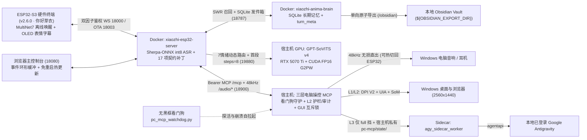

# 小智 ESP32-S3 · 雷电芽衣语音助手与三层电脑操控系统 · 项目交接与运维手册

> [!IMPORTANT]
> **项目根目录**：[xiaozhi-server](file:///e:/故事/1/xiaozhi-server)（外部显卡语音引擎目录：[gpt-sovits-studio](file:///e:/故事/1/gpt-sovits-studio)）
> **GitHub 开源仓库**：https://github.com/zou172866/xiaozhi-windows-pc-mcp
> **版本基线与回滚标签**：内存优化前基线 `v-pre-mem-opt`（`27263d7`）；便携化前基线 `v1.0-personal-mei`（`a936500`）；跨机解耦基线 `e22956a`；Batch 1～3 加固基线 `9711973`。
> **当前工作区状态（位于 `9711973` 之上，尚未提交推送）**：已完成 **P0 #1～#7（安全止血 + 记忆防丢）+ Obsidian 单向记忆导出 + P1 #8～#18（稳定性与延迟优化）+ P2 #19～#24（可观测性、模块拆分、配置合一、/api/state 减重、4 处 Bug 修复与三层测试体系）** 全部落地并实机部署验活，**全链路 119 项自动化测试全绿**（单元测试 `109` + 上游契约 `5` + 联机集成 `5`）。
> **AI 接手必读红线**：新会话或新 Agent 接手修改本目录前，务必先读 [AGENTS.md](file:///e:/故事/1/xiaozhi-server/AGENTS.md)、工作区运维技能 [xiaozhi-esp32-ops/SKILL.md](file:///e:/故事/1/xiaozhi-server/.agents/skills/xiaozhi-esp32-ops/SKILL.md) 与跨项目桌面操控技能 [SKILL.md](file:///C:/Users/Administrator/.gemini/config/skills/windows-pc-mcp-automation/SKILL.md)。

---

## 一、系统全景架构与端口矩阵



### 全链路端口分配表（统一 `>15000` 高位端口，彻底避开 Windows Hyper-V 动态端口征用）

| 宿主机端口 | 绑定范围 | 归属进程 / 容器 | 作用说明 | 访问或日志位置 |
| :--- | :--- | :--- | :--- | :--- |
| **`18000`** | `0.0.0.0` | Docker `xiaozhi-esp32-server` | ESP32 实时语音双向 WebSocket（容器 `8000`），**强制 MAC 白名单 + HMAC Bearer Token 双因子鉴权** | `ws://${HOST_LAN_IP}:18000/xiaozhi/v1/` |
| **`18003`** | `0.0.0.0` | Docker `xiaozhi-esp32-server` | ESP32 开机 OTA（`/xiaozhi/ota/`）与视觉接口（`/mcp/vision/explain`），均强制白名单与令牌鉴权 | `http://${HOST_LAN_IP}:18003/xiaozhi/ota/` |
| **`18080`** | `127.0.0.1` | Docker `xiaozhi-esp32-server` | **主可视化控制台**（三挡操控锁、L3 引擎热切、电脑音响热切、回复字数热调、亲密度热调、**Obsidian 同步卡片**、深度合并免重启保存、`/api/health` 补丁契约体检） | http://localhost:18080 |
| **`18787`** | `127.0.0.1` | Docker `xiaozhi-anima-brain` | **Companion Studio** 长期记忆面板 + `/xiaozhi/health` 队列/导出指标 + 内置 Obsidian 单向导出任务 | [打开Companion Studio控制台.bat](file:///e:/故事/1/xiaozhi-server/打开Companion%20Studio控制台.bat) |
| **`18900`** | `127.0.0.1` | 宿主机 `pc-mcp\.venv` Python | 三层电脑操控 MCP（`/mcp`）+ 48kHz WinMM 播音（`/audio/*`）+ 受限 `/l3/status`、`/l3/config`（带 `pc_mcp_watchdog.py` 无黑框守护） | `data\pc_mcp_18900.log`、`pc-mcp\state\watchdog_state.json` |
| **`19880`** | `127.0.0.1` | 宿主机 `gpt-sovits-studio\.venv` | `RTX 5070 Ti` 雷电芽衣 V4 / 台湾小智本地语音合成 API（60s 闲置自动回收） | `data\gsv_19880.log` |

---

## 二、硬件终端与固件交接记录（ESP32-S3）

- **固件版本与自定义唤醒词**：`bread-compact-wifi v2.6.0`（`0.91" SSD1306 128×32`、`partitions/v2/16m.csv`，16MB Flash + 8MB PSRAM，USB 串口当前为 `COM4`）
  - **离线自定义唤醒词与打断词**：`0x800000`（8MB `assets` 分区）搭载乐鑫原厂 `esp-sr 2.4.7` 的 `MultiNet7 (mn7_cn)` + `fst`，并行配置两条离线命令词：`ni hao ya yi` → **`你好芽衣`**、`ting wo shuo` → **`听我说`**（`threshold: 0.2`，`duration: 3000ms`）；播报中喊“听我说”立即触发 `abort`（~11ms 截断电脑音响）并直进聆听。
  - **芽衣专属唤醒秒回语与打断词直通聆听**：[data/.config.yaml](file:///e:/故事/1/xiaozhi-server/data/.config.yaml) 配置 `wakeup_words` 与 `interrupt_words`，[mei_emotion_router.py](file:///e:/故事/1/xiaozhi-server/data/mei_emotion_router.py) 对唤醒词播放芽衣短句、对打断词跳过寒暄与 2 秒 VAD 屏蔽直接聆听；且唤醒问候语已标记 `_standalone_assistant`，不会污染上一轮 Anima 记忆。
- **已验证焊接引脚定义**：
  - **INMP441 数字麦克风**：`WS = GPIO 4`、`SCK = GPIO 5`、`SD = GPIO 6`
  - **MAX98357A 数字功放**：`DIN = GPIO 7`、`BCLK = GPIO 15`、`LRC = GPIO 16`（严禁将 BTL 喇叭口直插电脑 Line-In 或有源音箱）
  - **SSD1306 OLED 显示屏**：`SDA = GPIO 41`、`SCL = GPIO 42`
- **鉴权与 NVS 交接说明**：
  - 设备 NVS `wifi` 命名空间（偏移 `0x9000`）指向本机局域网 `http://${HOST_LAN_IP}:18003/xiaozhi/ota/`。
  - **开启 P0 #1 双因子鉴权后，ESP32 必须重新上电/按 RST 键一次**，使其开机请求 `18003 /xiaozhi/ota/` 拉取最新签名 HMAC `websocket.token` 并写入 NVS（未重启前设备缓存的旧空 token 会被 `18000` 拒绝）。
  - 本机真实设备 MAC 与 64 位签名密钥均保存在被 `.gitignore` 隔离的本地 `.env`（`ESP32_ALLOWED_DEVICES`、`ESP32_AUTH_KEY`），严禁写入任何受版本跟踪的文件。
  - **本地 NVS 备份（均被 `*.bin` 排除，严禁提交）**：`data/nvs_v194_local_backup.bin`、`data/esp32_v194_boot_pt_nvs_backup.bin`、`data/nvs_original_backup.bin`。一键刷回官方云端：
    ```powershell
    esptool --chip esp32s3 --port COM4 write-flash 0x9000 "e:\故事\1\xiaozhi-server\data\nvs_original_backup.bin"
    ```

---

## 三、日常启停与运维快捷入口

所有 `.bat` 保持**纯 ASCII + CRLF**，底层委托给 **UTF-8 BOM + CRLF** 的 PowerShell 脚本，并通过 WMI `Win32_Process.Create`（`ShowWindow = 0`）无黑框静默运行：

1. **开机/日常一键启动或重启**：双击 [启动或重启服务.bat](file:///e:/故事/1/xiaozhi-server/启动或重启服务.bat)（调用 [start_all.ps1](file:///e:/故事/1/xiaozhi-server/data/start_all.ps1)）
   - 自动补全缺失的 `.env` 密钥（如 `ESP32_AUTH_KEY`）与目录（含 `pc-mcp\state` 与 `OBSIDIAN_EXPORT_DIR`）；
   - 先停旧看门狗，再平滑重启 `18900` MCP 并**带 Bearer Token 探活 `/audio/status`**（失败时自动打印 `boot.log` 最后 40 行），验活通过后拉起无黑框看门狗 [pc_mcp_watchdog.py](file:///e:/故事/1/xiaozhi-server/pc-mcp/pc_mcp_watchdog.py)；
   - 按需拉起 `19880` GPU 引擎（无独显自动优雅跳过走 `EdgeTTS`）→ 双 Docker 容器 → 预热并回收冷内存页。
2. **彻底关停释放显存与内存**：双击 [关闭小智服务.bat](file:///e:/故事/1/xiaozhi-server/关闭小智服务.bat)（调用 [stop_all.ps1](file:///e:/故事/1/xiaozhi-server/data/stop_all.ps1)）
   - 优雅停止双容器（`anima-brain` 享有 `25s` 排空期，自动回收内存延迟重试队列并刷盘 Obsidian）；
   - 写停止标志关闭 `pc_mcp_watchdog.py` → 调用 `pc_mcp_watchdog.py --cleanup-l3` 按 `create_time()` 定向清理运行中的 L3 子进程树 → 对 `18900` 与 `19880` 执行精准单 PID `Stop-Process`（**绝不对 `18900` 执行 `taskkill /T`**，保护已打开的用户浏览器窗口）→ 清理 `agy_sidecar_worker.py` → 无其他容器时自动退出 Docker Desktop。
3. **跨机首次初始化**：双击 [一键初始化配置.bat](file:///e:/故事/1/xiaozhi-server/一键初始化配置.bat)（调用 [init_setup.ps1](file:///e:/故事/1/xiaozhi-server/data/init_setup.ps1)）
   - 已升级为**增量合并 `.env`**（保留原有自定义项、注释与国内自配 Embedding），自动探测 `%APPDATA%\obsidian\obsidian.json` 本机 Vault 列表，自动初始化 `pc-mcp\state\l3_backend_config.json`（仅写 `backend` 与 `timeout_seconds`）且默认 `WORKBUDDY_AUTO_APPROVE=false`。
4. **控制台与日志快捷入口**：[打开网页控制台.bat](file:///e:/故事/1/xiaozhi-server/打开网页控制台.bat)（`18080`）、[打开Companion Studio控制台.bat](file:///e:/故事/1/xiaozhi-server/打开Companion%20Studio控制台.bat)（`18787`）、[查看实时日志.bat](file:///e:/故事/1/xiaozhi-server/查看实时日志.bat)。

---

## 四、核心子系统现状与本轮新增改动地图

### 1. 安全架构加固（P0 #1～#4 — 已完成）
- **ESP32 通道双因子鉴权（[start_with_env.py](file:///e:/故事/1/xiaozhi-server/data/start_with_env.py)、[.config.yaml](file:///e:/故事/1/xiaozhi-server/data/.config.yaml)、[.config.example.yaml](file:///e:/故事/1/xiaozhi-server/data/.config.example.yaml)）**：
  - 修补上游 `0.9.8` 三个鉴权缺陷：`OTAHandler`（非白名单 MAC 一律 `403`，仅白名单签发 HMAC `websocket.token`）、`WebSocketServer._handle_auth`（同时强制 MAC 白名单 + 有效 HMAC Bearer Token，并在拒绝时打印不含密钥的 `[esp32_auth]` 诊断日志）、`VisionHandler`（彻底移除 `Client-Id == "web_test_client"` 后门，强制有效 JWT + 匹配 `Device-Id` + MAC 白名单）；剥离上游默认假 MAC `11:22:33:44:55:66`，严禁使用字面量 `${ESP32_AUTH_KEY}` 签名。
  - 默认操控挡位改回 `safe`（统一模板 [runtime_settings.example.json](file:///e:/故事/1/xiaozhi-server/data/runtime_settings.example.json) 及 `pc_control_mcp.py` 缺失/损坏回退；旧版 `data/pc_control_mode.json` 仍支持自动无损迁移）。
- **切断容器 → 宿主机 RCE 路径（[l3_backends/\_\_init\_\_.py](file:///e:/故事/1/xiaozhi-server/pc-mcp/l3_backends/__init__.py)、[agy_sidecar_worker.py](file:///e:/故事/1/xiaozhi-server/pc-mcp/agy_sidecar_worker.py)、[console_server.py](file:///e:/故事/1/xiaozhi-server/data/console_server.py)）**：
  - 宿主机所有运行态迁至未挂载进 Docker 的私有目录 **`pc-mcp/state/`**（已加入 [.gitignore](file:///e:/故事/1/xiaozhi-server/.gitignore)）：
    - `pc-mcp/state/l3_backend_config.json`（仅持久化 `backend` 与 `timeout_seconds`）
    - `pc-mcp/state/agy_tasks/`（`pending/`、`active/`、`worker_heartbeat.json`）
    - `pc-mcp/state/l2_audit.jsonl`（L2 脱敏审计日志）
    - `pc-mcp/state/last_som_grounding.jpg`（视觉落点核验图）
    - `pc-mcp/state/watchdog_state.json`（18900 看门狗健康状态）
  - 旧 `./data/l3_backend_config.json` 与 `./data/agy_tasks/` 已安全迁移并删除。
  - `18900 POST /l3/config` 与 `18080 POST /api/l3-backend` 严格限制仅接受 `backend` 与 `timeout_seconds`（别名 `timeout`），提交 `dsh_cmd`、`workbuddy_cmd`、`workdir`、`workbuddy_auto_approve` 或非法字段一律返回 HTTP `400`；宿主机命令、工作目录与自动批准开关**仅从宿主机 `.env`/环境变量读取**。
  - `agy_sidecar_worker.py` 与各后端强制 `TASK_ID_RE = [A-Za-z0-9_-]{1,64}` `fullmatch` + Windows 保留设备名拒绝 + `.resolve().is_relative_to()` 路径 containment + `conversation_id` UUID 校验。
- **L3 `full` 挡门禁与 L2 视觉键鼠护栏（[pc_control_mcp.py](file:///e:/故事/1/xiaozhi-server/pc-mcp/pc_control_mcp.py)、[workbuddy.py](file:///e:/故事/1/xiaozhi-server/pc-mcp/l3_backends/workbuddy.py)）**：
  - `pc_agent_task` 仅在 `full` 挡位放行（`off`/`safe`/`standard` 一律拒绝）；`workbuddy_auto_approve` 全局默认 `False`（默认不传 `-y`）。
  - `type_text` 指定目标元素未定位到时 fail-closed 直接报错，不盲打当前焦点窗口。
  - `hotkey` 拦截高危热键（`win+r`、`win+x`、`ctrl+shift+esc`、`ctrl+alt+del`、`win+l`/`s`/`q`/`pause`、`ctrl+esc`、单 `win`），支持别名/顺序归一、**多键高危组合子集拦截**（挡住 `win+r+noop` / `win+r+a` 尾部绕过）与 `pyautogui.isValidKey()` 逐键校验。
  - 前台窗口为终端（`cmd`/`powershell`/`pwsh`/`WindowsTerminal`/`wt`/`conhost`/`openconsole`/`wsl`/`bash` 等）或 Windows「运行 / Run」对话框时拒绝键盘输入。
  - 每次 L2 动作（放行与拦截）写入 `pc-mcp/state/l2_audit.jsonl`，键入正文仅记录 `[REDACTED len=N]`，窗口标题与详情经过凭据正则脱敏。

### 2. 记忆防丢与 Obsidian 单向同步（P0 #5～#7 + 3.1～3.6 — 已完成）
- **端到端零丢轮链路**：
  - [start_with_env.py](file:///e:/故事/1/xiaozhi-server/data/start_with_env.py)：包裹 `ConnectionHandler.chat` 与 `_handle_function_result`，整轮（含工具调用）结束后统一提交，记录真实 `_occurred_at` 与 `_used_tools`，并隔离独立唤醒问候语不污染上一轮。
  - [anima_memory_provider.py](file:///e:/故事/1/xiaozhi-server/data/anima_memory_provider.py)：落地持久化 SQLite 发件箱 `data/anima_outbox.sqlite`（已 `.gitignore`），容器启动自动拉起单后台重试线程指数退避重传、按 `request_id` 幂等；`console_server.py` 触发 `os._exit(0)` 重启前先 `flush_outbox()`。
  - [xiaozhi_anima_service.py](file:///e:/故事/1/xiaozhi-server/anima-brain/xiaozhi_anima_service.py)：新增 `xiaozhi_turn_meta` 旁表保存 `occurred_at`/`source`/`device_id`/`used_tools`；同 `request_id` 收到更长回复或元数据升级时执行 upsert；遇到 `another_turn_pending` 改为延迟重入队并在优雅停机时回收刷盘（停机期间新请求返回 `503` 留给客户端发件箱），`/xiaozhi/health` 暴露队列与丢弃统计。
- **Obsidian 单向导出（[obsidian_exporter.py](file:///e:/故事/1/xiaozhi-server/anima-brain/obsidian_exporter.py)）**：
  - 运行在 `xiaozhi-anima-brain` 容器内，经 `engine._lock` 安全读库（**严禁在 Windows 宿主机直接打开 WAL 模式的 `brain.sqlite3`**），通过 `${OBSIDIAN_EXPORT_DIR:-./data/obsidian_export}:/obsidian` 卷挂载输出（本机 `.env` 当前配置为 `OBSIDIAN_SYNC_ENABLED=true`，指向本地独立私密 Vault，不做每日日志插链）。
  - 目录布局：根目录 `总览.md` + `对话/YYYY/MM/YYYY-MM-DD.md` + `记忆/`（`芽衣记得的事.md`、`未完待续.md`、`关系与情绪状态.md`、`核心人物笔记.md`、`互动片段/`）。
  - 写入策略：`.tmp` + `os.replace` 原子写 + SHA-256 哈希去重；首次启动全量回填；日常对话后防抖 5 秒仅更新当天及延迟补单落入日期，历史日默认冻结；`18080` 控制台「Obsidian 同步」卡片支持热开关与「立即全量重建」。
  - 内容与隐私：每轮末尾生成唯一 `^t-<8位>` 块 ID（已防御多行 Markdown 块分割、未闭合反引号/`%%`/`<!--`/`$$` 及行尾反斜杠），所有记忆与片段均带 `[[对话/...#^t-...|原话]]` 双链；`芽衣记得的事.md` 主区仅放有效事实，历史修订收于文末 `> [!abstract]-` 折叠区；复用 `automation.py` 规则自动脱敏 API Key / Token / 密码（且不误伤英文 `basic <word>`）。

### 3. 稳定性、低延迟与可运维性升级（P1 #8～#18 — 已完成）
- **P1 #8 & #12 补丁注册表与通用重绑（[patch_registry.py](file:///e:/故事/1/xiaozhi-server/data/patch_registry.py)）**：17 项核心补丁全部透传 `(*args, **kwargs)`、启动校验 `SERVER_VERSION` 与 `inspect.signature` 契约、4 处提示词锚点 `assert` 校验；通用 `rebind()` 遍历 `sys.modules` 自动修复早绑引用（已实证重绑 `listenMessageHandler.send_tts_message`、`helloHandle.send_tts_message`、`receiveAudioHandle.handleAbortMessage` 等）；任意补丁或版本异常时 `GET /api/health` 立即返回 `degraded: true`。
- **P1 #9 召回硬预算与 SWR（[anima_memory_provider.py](file:///e:/故事/1/xiaozhi-server/data/anima_memory_provider.py)）**：`httpx.Timeout(0.8, connect=0.2)` + 外层 `asyncio.wait_for(..., 0.6)` + 熔断器 + Stale-While-Revalidate 后台刷新（0ms 返回上轮缓存不阻塞首句）。
- **P1 #10 首句音频提速（[mei_emotion_router.py](file:///e:/故事/1/xiaozhi-server/data/mei_emotion_router.py)）**：首句强标点切分上限 `20` 字（`FIRST_SENTENCE_MAX_STRONG_CHARS = 20`），首段合成独立使用 `sample_steps = 8`（线上 19880 实测首段快约 130～317ms），后续段落保持 `16`。
- **P1 #11 & #13 & #14 控制台去正则、免重启热更新与试听保护（[runtime_events.py](file:///e:/故事/1/xiaozhi-server/data/runtime_events.py)、[console_server.py](file:///e:/故事/1/xiaozhi-server/data/console_server.py)、[console.html](file:///e:/故事/1/xiaozhi-server/data/console.html)）**：
  - 聊天面板与设备状态由 `Dialogue.put` / `send_tts_message` / `abort` / `connection_closed` 进程内环形缓冲直推，不再解析中文日志正则；
  - 保存配置改为仅深度合并用户修改过的字段，提示词/LLM/同引擎音色/空闲跨引擎均免重启热生效（按钮文案已更新为「保存并立即生效」；仅当活跃 ESP32 连接跨 `GPT_SOVITS_V2 ↔ EdgeTTS` 引擎时才先 flush 发件箱后平滑重启）；
  - 设备播报中拒绝试听非当前 GPU 音色（HTTP `409`）；权重切换后立即标记 `__dirty__`，半途失败也在 `finally` 完整恢复线上权重。
- **P1 #15～#18 宿主机看门狗、GUI 锁、回收容错与锁依赖**：
  - [pc_mcp_watchdog.py](file:///e:/故事/1/xiaozhi-server/pc-mcp/pc_mcp_watchdog.py)：无黑框后台守护 `18900`，按严格 Python argv 匹配防止误杀旁观进程，支持 `--cleanup-l3` 按 `create_time()` 清理 L3 子进程树；
  - [pc_control_mcp.py](file:///e:/故事/1/xiaozhi-server/pc-mcp/pc_control_mcp.py)：GUI 操作全局互斥锁覆盖 `pc_ui_action` / `pc_open_app_or_web` / `pc_look_at_screen` / `pc_inspect_window_ui`；
  - 坏任务文件单文件 `try` 隔离容错，回收进程核对 `pid` + `create_time()` 防 PID 复用误杀；
  - [requirements.txt](file:///e:/故事/1/xiaozhi-server/pc-mcp/requirements.txt) 全部 45 包锁定 `==` + `--hash=sha256:...`（含 `uvicorn`、`starlette`），[dsh.py](file:///e:/故事/1/xiaozhi-server/pc-mcp/l3_backends/dsh.py) 锁定 `@deepseek-ai/dsh@0.2.2-rc.5`。

### 4. 可维护性、自定义告别与三层测试体系（P2 #20～#24 + 空闲告别升级 — 已完成）
- **空闲超时告别语双模式（第 18 项契约补丁 `idle_farewell` + DeepSeek DSML 泄漏标签过滤）**：在 [mei_emotion_router.py](file:///e:/故事/1/xiaozhi-server/data/mei_emotion_router.py) 接管 `receiveAudioHandle.no_voice_close_connect`，支持 `18080` 免重启切换「固定随机台词」与「AI 简短总结本轮对话 + 依恋不舍」模式（零假字幕/零记忆污染，生成中开口即取消，无对话或超时自动降级固定台词）；同步拦截 DeepSeek V4.1 Flash 偶发泄漏的 `</｜｜DSML｜｜ ...>` 闭合标签。原 P2 #19 延迟观测埋点与面板已按极简原则全量移除。
- **P2 #20 模块拆分与公共工具去重（[xz_common.py](file:///e:/故事/1/xiaozhi-server/data/xz_common.py)、`pc-mcp/pc_mcp_modules/`）**：
  - 容器侧以 `xz_common.py` 统一原子写（`atomic_write_text`/`atomic_write_json`）、`MtimeJsonCache` 与令牌缓存读取；
  - 宿主机 `pc-mcp/pc_control_mcp.py` 从 2627 行瘦身为约 315 行薄入口，核心能力按职责拆入 `pc-mcp/pc_mcp_modules/{winapi,security,launcher,vision,ui_tools,audio_bridge}.py` 并保留全量兼容 re-export。
- **P2 #21 运行态配置合一与默认值统一（[runtime_settings.py](file:///e:/故事/1/xiaozhi-server/data/runtime_settings.py)、[runtime_settings.example.json](file:///e:/故事/1/xiaozhi-server/data/runtime_settings.example.json)）**：将 `pc_control_mode.json`、`audio_output_mode.json`、`reply_length_config.json` 合并为带 `schema_version: 1` 的单源真值 `data/runtime_settings.json`（首次自动无损合并迁移并将旧文件归档为 `*.migrated.bak`，宿主机私有 `pc-mcp/state/l3_backend_config.json` 继续保持隔离）；全仓库 `L3_BACKEND` 未配置回退默认值统一为 `dsh`。
- **P2 #22 `/api/state` 减重（[console_server.py](file:///e:/故事/1/xiaozhi-server/data/console_server.py)、[console.html](file:///e:/故事/1/xiaozhi-server/data/console.html)）**：`18900`/`19880`/`18787` 状态探活迁入 3 秒后台守护线程（含连续 2 次失败防抖），`/api/state` 零同步网络阻塞（实机约 10ms 返回）；日志支持 `?log_cursor=<N>` 增量返回与重启自动重置，同时保留无参全量向后兼容。
- **P2 #23 4 处已知小 Bug 修复**：`reply_length_router.py` 的 `max_tokens` 支持随配置下调；`nmc_weather_patch.py` 省份抓取不完整时跳过落盘保护完整缓存；`screen_off` 改为 `SendMessageTimeoutW(..., SMTO_ABORTIFHUNG, 2000)`；`pc_mcp_token.txt` 与 `studio_token.txt` 读遇临时 I/O 异常重试并拒绝静默覆写重建。
- **P2 #24 三层测试体系（[run_tests.py](file:///e:/故事/1/xiaozhi-server/scripts/run_tests.py)、[test_upstream_contracts.py](file:///e:/故事/1/xiaozhi-server/data/test_upstream_contracts.py)）**：清晰划分为「单元测试（`unit` 109 项）/ 上游契约测试（`contract` 5 项，升级镜像必跑）/ 联机集成测试（`live` 5 项）」，保留原有全部测试命令零破坏。

### 5. 其余已稳固能力（Batch 1～3 保留项）
- **轻量 ASR 与内存治理**：默认 `SherpaASR`（`models/sherpa-onnx-sense-voice/model.int8.onnx`）+ 懒加载 `modelscope` + `SileroVAD`（`1100ms` 防抢话）+ 180s `malloc_trim(0)`；`gpt-sovits-studio` 本地保留 CUDA FP16 G2PW、8 槽写前分离 LRU 与 60s 闲置回收（回滚补丁见 [pre_mem_opt_backup.patch](file:///e:/故事/1/gpt-sovits-studio/pre_mem_opt_backup.patch)）。
- **48kHz 电脑音响直出、回复字数热调、亲密度热调、免 Key 天气**：[pc_audio_router.py](file:///e:/故事/1/xiaozhi-server/data/pc_audio_router.py)、[reply_length_router.py](file:///e:/故事/1/xiaozhi-server/data/reply_length_router.py)、[nmc_weather_patch.py](file:///e:/故事/1/xiaozhi-server/data/nmc_weather_patch.py) 均完整保留并纳入回归覆盖。

---

## 五、常见故障速查与 119 项三层自动化体检命令

| 故障现象 / 需求 | 排查点 | 解决动作 |
| :--- | :--- | :--- |
| **开启鉴权后 ESP32 连不上（`18000` 秒断）** | `docker logs xiaozhi-esp32-server` 查 `[esp32_auth]` | **给 ESP32 断电重启或按 RST 键**，让它开机请求 `18003 /xiaozhi/ota/` 拉取新签名 `token`；同时核对本地 `.env` 中 `ESP32_ALLOWED_DEVICES` 与 `HOST_LAN_IP` |
| **L3 派单或 L2 点击被安全策略拒绝** | `18080` 顶部挡位 / `pc-mcp\state\l2_audit.jsonl` | 切至 **【全权操控挡 (`full`)】**；若 L2 仍被拒，核对审计日志是否触发「前台终端/运行框拒输」「目标元素未定位」或「高危热键黑名单」 |
| **电脑音响不出声或 `18900` 异常** | `pc-mcp\state\watchdog_state.json` / `data\pc_mcp_18900_boot.log` | 看门狗会自动重启 `18900`；若持续失败，双击 [启动或重启服务.bat](file:///e:/故事/1/xiaozhi-server/启动或重启服务.bat) 查看自动打出的 `boot.log` 尾部 |
| **控制台提示 `degraded` 或升级上游镜像后异常** | `GET http://127.0.0.1:18080/api/health` / `contract` 测试层 | 运行 `python scripts/run_tests.py --layer contract` 定位签名或提示词锚点变更 |
| **Obsidian 笔记未更新或想按新模板全量重刷** | `18080` 「Obsidian 同步」卡片 / `18787 /xiaozhi/health` | 核对 `.env` 中 `OBSIDIAN_SYNC_ENABLED=true` 与 `OBSIDIAN_EXPORT_DIR` 目录可写，点「立即全量重建」 |
| **小智有字幕但完全不出声** | `19880` 端口 / `data\gsv_19880.log` | 双击 [启动或重启服务.bat](file:///e:/故事/1/xiaozhi-server/启动或重启服务.bat) 重拉 `19880` 显卡配音服务 |
| **L3 反重力派单显示离线** | Antigravity 设置 → Sidecars | 确认 `Xiaozhi Bridge` 开启并检查 `pc-mcp\state\agy_tasks\worker_heartbeat.json` |
| **Anima Brain 总结 503 或 `auto_retry_exhausted`** | `docker logs xiaozhi-anima-brain` / `18787` | 在 `.env` 将 `ANIMA_SUMMARY_BASE_URL` / `ANIMA_SUMMARY_MODEL` 切至 DeepSeek 并在 `18787` Acknowledge 恢复 |
| **核验鼠标视觉点击落点** | `pc-mcp\state\last_som_grounding.jpg` | 查看绿十字准星落点与红底编号框 |

### 全链路 119 项三层自动化体检命令

```powershell
# 一键分层运行器（推荐）：unit=109 项 | contract=5 项（升级镜像必跑）| live=5 项 | all=119 项
python E:\故事\1\xiaozhi-server\scripts\run_tests.py --layer all

# 也可继续使用各子系统独立入口：
# 1. 上游镜像契约层（5 项）
docker exec xiaozhi-esp32-server python3 /opt/xiaozhi-esp32-server/data/test_upstream_contracts.py
# 2. 容器离线 + 联机集成（39 离线 + 5 联机 = 44 项）
docker exec xiaozhi-esp32-server python3 /opt/xiaozhi-esp32-server/data/test_mei_emotion_and_prosody.py --live
# 3. 宿主机 pc-mcp 全套（47 项，含模块化拆分、SendMessageTimeoutW、.bat/.ps1 编码校验）
E:\故事\1\xiaozhi-server\pc-mcp\.venv\Scripts\python.exe -m unittest discover -s E:\故事\1\xiaozhi-server\pc-mcp -p "test_*.py" -v
# 4. Anima Brain 记忆防丢与 Obsidian 导出（23 项，容器镜像内只读隔离执行）
docker run --rm --entrypoint python `
  -v "E:\故事\1\xiaozhi-server\anima-brain\tests:/app/tests:ro" `
  -v "E:\故事\1\xiaozhi-server\anima-brain\obsidian_exporter.py:/app/obsidian_exporter.py:ro" `
  -v "E:\故事\1\xiaozhi-server\anima-brain\xiaozhi_anima_service.py:/app/xiaozhi_anima_service.py:ro" `
  xiaozhi-anima-brain:local -m unittest /app/tests/test_xiaozhi_service.py /app/tests/test_obsidian_exporter.py -v
```

---

## 六、接手待办清单（按推荐优先级）

1. **Obsidian 进阶选项（原文档 3.7，按需确认实施）**：
   - 反向备忘收件箱（「给芽衣的备忘.md」单向提交 `correction`）；
   - 严格白名单读笔记导入 Anima `documents`；
   - Dataview / Bases 月度对话与情绪动态看板。
2. **真机与桌面人工复验（自动化未覆盖项）**：
   - **ESP32-S3 断电重启复验**：重启设备验证 `18003 OTA → 18000 双因子 WS` 顺畅握手；实测语音首句 `sample_steps=8` + 20 字短切听感，以及空闲超时后芽衣「总结本轮对话 + 依恋不舍」告别与播报中喊「听我说」打断；
   - **Obsidian 桌面客户端抽检**：在 Obsidian 打开本地 Vault，验证 `总览.md`、`记忆/芽衣记得的事.md` 的 `[[对话/...#^t-...|原话]]` 块引用跳转与文末 `> [!abstract]-` 折叠块渲染；
   - **18080 浏览器实测**：验证「空闲超时告别语」双模式热切、「Obsidian 同步」卡片、「保存并立即生效」免重启热更新及增量日志刷新。
3. **Git 脱敏核验与提交推送**：
   - 本轮 `P0 #1～#7 + Obsidian + P1 #8～#18 + P2 #19～#24` 改动目前均在本地工作区尚未提交；
   - 提交前务必按 [AGENTS.md](file:///e:/故事/1/xiaozhi-server/AGENTS.md) 执行 `git add -n .` 核验 `.env`、`*.bin`、`data/anima/`、`data/anima_outbox.sqlite*`、`data/runtime_settings.json`、`data/*.migrated.bak`、`pc-mcp/state/` 均被拦截且无密钥/MAC/个人路径泄漏。
