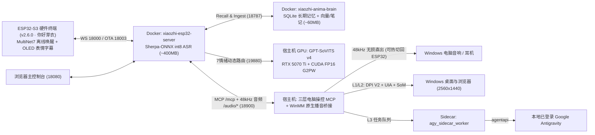

# 小智 ESP32-S3 · 雷电芽衣语音助手与三层电脑操控系统 · 项目交接与运维手册

> [!IMPORTANT]
> **项目根目录**：[xiaozhi-server](file:///e:/故事/1/xiaozhi-server)（外部显卡语音引擎目录：[gpt-sovits-studio](file:///e:/故事/1/gpt-sovits-studio)）
> **GitHub 开源仓库**：https://github.com/zou172866/xiaozhi-windows-pc-mcp
> **版本基线与回滚标签**：内存优化前基线标签 `v-pre-mem-opt`（`27263d7`）；便携化改造前本机基线标签 `v1.0-personal-mei`（`a936500`）；跨机解耦与可插拔 L3 基线 `e22956a`；**当前已在 `e22956a` 之上完成 Batch 1 + Batch 2 + Batch 3 全量加固与优化（53 项自动化测试全绿）**：Batch 1（Anima Brain 自愈/瘦身/排空 + 18080 聊天游标零重复 + 跨机开箱 5 处修复）+ Batch 2（18900/19880/18080/18787 收紧 `127.0.0.1` + 自动 Bearer Token + DNS Rebinding/CSRF/日志脱敏 + 去 `seccomp:unconfined` + `pc_audio_router` 去重等待/动态轮询/防过期 `stop` 竞态 + WinMM `CALLBACK_EVENT` 双缓冲与线性/`tanh` 软限幅 + GPT-SoVITS V4 `sample_steps=16` 与 8 槽写前分离 LRU `(fea_ref, ge, mel2)` 缓存 + `requests.Session()`/`NO_PROXY`/`trust_env=False`）+ Batch 3（L3 `.cmd`/`.bat` 拆壳与防引号注入清洗 + 超时子进程树定向清理 + 线程追踪与保序僵尸 `running` 自动回收 + 全局原子写/MTA COM 统一/剪贴板保护/去 `shell=True` + 18900 日志过滤轮转 + Docker 镜像摘要锁定/健康检查/日志轮转 + 控制台切后台停轮询 + 离线/线上测试分离）
> **AI 接手必读红线**：新会话或新 Agent 接手修改本目录前，务必先读 [AGENTS.md](file:///e:/故事/1/xiaozhi-server/AGENTS.md)、工作区运维技能 [xiaozhi-esp32-ops/SKILL.md](file:///e:/故事/1/xiaozhi-server/.agents/skills/xiaozhi-esp32-ops/SKILL.md) 与跨项目桌面操控技能 [SKILL.md](file:///C:/Users/Administrator/.gemini/config/skills/windows-pc-mcp-automation/SKILL.md)。

---

## 一、系统全景架构与端口矩阵



### 全链路端口分配表（统一 `>15000` 高位端口，彻底避开 Windows Hyper-V 动态端口征用）

| 宿主机端口 | 归属进程 / 容器 | 作用说明 | 访问或日志位置 |
| :--- | :--- | :--- | :--- |
| **`18000`** | Docker `xiaozhi-esp32-server` | ESP32 实时语音双向 WebSocket 主通道（容器内 `8000`） | `ws://${HOST_LAN_IP}:18000/xiaozhi/v1/`（本机 `192.168.31.200`） |
| **`18003`** | Docker `xiaozhi-esp32-server` | ESP32 开机 OTA 握手下发配置接口（容器内 `8003`） | `http://${HOST_LAN_IP}:18003/xiaozhi/ota/`（本机 `192.168.31.200`） |
| **`18080`** | Docker `xiaozhi-esp32-server` | **主可视化控制台**（三挡操控锁、**L3 后台 Agent 四选一热切**、**电脑音响/ESP32 热切与增益**、**日常/故事字数热调**、**亲密度与浪漫尺度热调**、模型切换、7 情绪试听、实时对话游标零重复） | http://localhost:18080 |
| **`18787`** | Docker `xiaozhi-anima-brain` | **Companion Studio** 长期记忆库、人物笔记与情绪余温面板（`stop_grace_period: 25s` 优雅排空） | [打开Companion Studio控制台.bat](file:///e:/故事/1/xiaozhi-server/打开Companion%20Studio控制台.bat)（委托 `data\open_studio.ps1`） |
| **`18900`** | 宿主机 `pc-mcp\.venv` Python | Windows 三层电脑操控 MCP（`/mcp`）+ **48kHz WinMM 电脑音响直通接口**（`/audio/*`）+ **L3 引擎探测与热切**（`/l3/status`、`/l3/config`） | `data\pc_mcp_18900.log` |
| **`19880`** | 宿主机 `gpt-sovits-studio\.venv` | `RTX 5070 Ti` 雷电芽衣 V4 / 台湾小智本地语音合成 API（含 60s 闲置自动冷页回收） | `data\gsv_19880.log` |

---

## 二、硬件终端与固件交接记录（ESP32-S3）

- **固件版本与自定义唤醒词**：`bread-compact-wifi v2.6.0`（`0.91" SSD1306 128×32`、`partitions/v2/16m.csv`，16MB Flash + 8MB PSRAM，USB 串口当前为 `COM4`）
  - **离线自定义唤醒词与打断词**：`0x800000`（8MB `assets` 分区）搭载乐鑫原厂 `esp-sr 2.4.7` 的 **`MultiNet7 (mn7_cn)` + `fst`**，并行配置两条自定义命令词：`ni hao ya yi` → **`你好芽衣`**、`ting wo shuo` → **`听我说`**（`threshold: 0.2`，`duration: 3000ms`）；播报中喊“听我说”立即触发 `abort`（~11ms 截断电脑音响）并直进聆听；如需调整灵敏度或增减词条，只需重打包并单刷 `0x800000` 的 `assets.bin`（~10 秒，不影响主固件与 Wi-Fi）；
  - **芽衣专属唤醒秒回语与打断词直通聆听**：服务端 [data/.config.yaml](file:///e:/故事/1/xiaozhi-server/data/.config.yaml) 已配置 `wakeup_words`（含 `你好芽衣` 及常见同音词）与 `interrupt_words`（`听我说`），[mei_emotion_router.py](file:///e:/故事/1/xiaozhi-server/data/mei_emotion_router.py) 对唤醒词自动播放芽衣温柔短句（默认兜底音频 `data/voices/raiden_mei/wakeup_mei_default.wav`），对打断词跳过寒暄与 2 秒 VAD 屏蔽直接静音开麦。
- **已验证焊接引脚定义**：
  - **INMP441 数字麦克风**：`WS = GPIO 4`、`SCK = GPIO 5`、`SD = GPIO 6`
  - **MAX98357A 数字功放**：`DIN = GPIO 7`、`BCLK = GPIO 15`、`LRC = GPIO 16`（若未来升级外接板载喇叭，选用 4Ω 3W 腔体喇叭并在 `VIN`/`GND` 并 `470~1000µF` 电容；**严禁将 BTL 喇叭口直插电脑 Line-In 或有源音箱**）
  - **SSD1306 OLED 显示屏**：`SDA = GPIO 41`、`SCL = GPIO 42`（0.91 寸 128×32）
- **NVS 分区与回退方法**：
  - 设备 NVS `wifi` 命名空间（偏移 `0x9000`）已原位保留本机局域网 `http://192.168.31.200:18003/xiaozhi/ota/` 与家庭 Wi-Fi 凭证（升级前后免重配网）。
  - **本地备份文件**（均已被 [.gitignore](file:///e:/故事/1/xiaozhi-server/.gitignore) `*.bin` 排除，严禁提交）：
    - `data/nvs_v194_local_backup.bin`：升级前含 Wi-Fi + 本地 `18003` OTA 的热备份；
    - `data/esp32_v194_boot_pt_nvs_backup.bin`：升级前 `0x0..0x10000` 引导与 v1 分区表备份；
    - `data/nvs_original_backup.bin`：出厂官方云端原始 NVS 备份。
  - **若宿主机局域网 IP 变化**：更新本地 `.env` 的 `HOST_LAN_IP`（默认已由 `start_all.ps1` 自动探测）并重启服务，如硬件静态指向旧 IP 则同步重刷 NVS `ota_url`。
  - **一键刷回官方小智服务器命令**：
    ```powershell
    esptool --chip esp32s3 --port COM4 write-flash 0x9000 "e:\故事\1\xiaozhi-server\data\nvs_original_backup.bin"
    ```

---

## 三、日常启停与运维快捷入口

所有 `.bat` 保持**纯 ASCII + CRLF**，底层委托给 UTF-8 BOM PowerShell 脚本，并通过 WMI `Win32_Process.Create`（`ShowWindow = 0`）无黑框静默运行：

1. **开机/日常一键静默启动**：双击 [启动或重启服务.bat](file:///e:/故事/1/xiaozhi-server/启动或重启服务.bat)（调用 [start_all.ps1](file:///e:/故事/1/xiaozhi-server/data/start_all.ps1)）
   - 自动按序拉起 Docker → `18900` MCP 与电脑音响桥接 → `19880` 显卡配音服务（注入 `GSV_IDLE_TRIM_SECONDS=60`）→ 双容器（冷启 ~2 秒）→ 预热并自动回收 `19880`/`18900` 冷内存页与 WSL2 文件缓存。
2. **打大型游戏/不用时彻底关停释放显存**：双击 [关闭小智服务.bat](file:///e:/故事/1/xiaozhi-server/关闭小智服务.bat)（调用 [stop_all.ps1](file:///e:/故事/1/xiaozhi-server/data/stop_all.ps1)）
   - 停止双容器（`anima-brain` 享有 `25s` 优雅排空期防丢记忆）、按 PID 精准停止 `18900` / `19880`（绝不误杀已打开的浏览器）并清理残留 `agy_sidecar_worker.py` 进程与心跳文件，最后在无其他容器时自动退出 Docker Desktop 与 WSL2 释放 Vmmem。
3. **打开 `18080` 主控制台**：双击 [打开网页控制台.bat](file:///e:/故事/1/xiaozhi-server/打开网页控制台.bat)
4. **打开 `18787` 长期记忆面板**：双击 [打开Companion Studio控制台.bat](file:///e:/故事/1/xiaozhi-server/打开Companion%20Studio控制台.bat)
5. **实时查看运行日志**：双击 [查看实时日志.bat](file:///e:/故事/1/xiaozhi-server/查看实时日志.bat)

---

## 四、核心子系统交接清单与文件地图

### 1. 密钥安全、大模型与轻量化语音识别
- **核心文件**：[docker-compose.yml](file:///e:/故事/1/xiaozhi-server/docker-compose.yml)、[start_with_env.py](file:///e:/故事/1/xiaozhi-server/data/start_with_env.py)、[.config.yaml](file:///e:/故事/1/xiaozhi-server/data/.config.yaml)
- **密钥零落盘**：仅从 Windows 环境变量 `DEEPSEEK_API_KEY` 与 `GEMINI_API_KEY` 内存注入。
- **双模型热切**：默认 `DeepSeekLLM`（`deepseek-flash` V4.1 原生多模态视觉，国内低延迟），控制台保留一键切换 `GeminiOpenAI`（`gemini-3.5-flash-lite`）。
- **轻量 `SherpaASR`（SenseVoiceSmall int8 ONNX）**：
  - 默认 `selected_module.ASR: SherpaASR`，模型位于 `models/sherpa-onnx-sense-voice/`（`model.int8.onnx` 228 MB + `tokens.txt`），原 `models/SenseVoiceSmall/model.pt` 完整保留作回滚备份；
  - `start_with_env.py` 内置本地文件优先的 `modelscope` 懒加载守卫（避免无谓拖入 `+330 MB` PyTorch/scipy）、异步线程 `decode_stream` 与每 180 秒 `glibc malloc_trim(0)`；容器内存由 `3.54 GB` 降至 **`~385 MB`**，冷启由 `~15s` 缩短至 **`~2s`**，本地转写 `90~190 ms`。
- **防抢话 VAD**：`SileroVAD`（ONNX）静默阈值 `min_silence_duration_ms: 1100`、`threshold_low: 0.2`，自然换气不截断。

### 2. Windows 电脑音响 48kHz 原声直通系统（零硬件、免重启热切）
- **核心文件**：[pc_audio_router.py](file:///e:/故事/1/xiaozhi-server/data/pc_audio_router.py)、[audio_output_mode.json](file:///e:/故事/1/xiaozhi-server/data/audio_output_mode.json)、[pc_control_mcp.py](file:///e:/故事/1/xiaozhi-server/pc-mcp/pc_control_mcp.py)、[console_server.py](file:///e:/故事/1/xiaozhi-server/data/console_server.py)、[console.html](file:///e:/故事/1/xiaozhi-server/data/console.html)
- **工作机制**：
  - **宿主机端（复用 `18900`）**：基于 Windows 原生 `winmm.dll`（`waveOut`）实现零额外依赖的 48kHz 无损 PCM 顺序播放队列，提供 `GET /audio/status`、`POST /audio/play`、`POST /audio/stop`、`GET /audio/wait`，**独立于电脑操控安全挡**（关闭电脑操控时依然正常播报），自动跟随系统默认音箱/耳机并与桌面声音混音；
  - **容器侧精准锁步**：`pc_audio_router.py` 在 `mei_emotion_router` 之前拦截 `to_tts_stream` 获取原生 48kHz WAV（以及 EdgeTTS/唤醒词），向 ESP32 下发等长数字静音 Opus 帧占位以保持 `SPEAKING` 状态；在 `mei_emotion_router` 之后拦截 `send_tts_message`，在 `sentence_start` 毫秒级触发电脑播音并同步刷新 ESP32 OLED 字幕与表情，在 `stop` 阶段等待电脑音箱真正播完最后一毫秒再开放麦克风（防尾音回声误触）；
  - **瞬间打断与断线兜底**：按键打断（`handleAbortMessage`）实测 **`~11 ms`** 截断电脑出声；若 `18900` 离线自动无感回退 ESP32 本机喇叭；
  - **`18080` 控制台**：提供 **「ESP32 本机喇叭 / Windows 电脑音响」免重启热切换**、`20%～150%` 增益滑块与 **「电脑音响试播」** 按钮（当前默认：`pc`、`100%`）。

### 3. 三层 Windows 电脑操控、可插拔 L3 引擎与高分屏精准定位
- **核心文件**：[pc_control_mcp.py](file:///e:/故事/1/xiaozhi-server/pc-mcp/pc_control_mcp.py)、[l3_backends](file:///e:/故事/1/xiaozhi-server/pc-mcp/l3_backends/__init__.py)、[agy_sidecar_worker.py](file:///e:/故事/1/xiaozhi-server/pc-mcp/agy_sidecar_worker.py)、[.mcp_server_settings.json](file:///e:/故事/1/xiaozhi-server/data/.mcp_server_settings.json)
- **三挡安全锁 + L3 引擎热切**（`data/pc_control_mode.json`、`data/l3_backend_config.json`，`18080` 秒切免重启）：安全挡 `关闭 / 安全挡 / 全权挡`；L3 后台 Agent 引擎支持 **`Google Antigravity` / `DeepSeek DSH` / `腾讯 WorkBuddy (CodeBuddy CLI)` / `关闭 L3`** 四选一实时热切与本机可用性探测。
- **跨电脑便携部署与模板隔离**：新电脑双击 [一键初始化配置.bat](file:///e:/故事/1/xiaozhi-server/一键初始化配置.bat)（调用 [init_setup.ps1](file:///e:/故事/1/xiaozhi-server/data/init_setup.ps1)）或直接双击 [启动或重启服务.bat](file:///e:/故事/1/xiaozhi-server/启动或重启服务.bat) 均会按需从 `data/*.example.*` 自动生成 6 份本地运行态配置（`data/.config.yaml`、`data/pc_control_mode.json` 默认 `safe`、`data/audio_output_mode.json` 默认 `esp32`、`data/reply_length_config.json`、`data/tts_infer_xiaozhi.yaml`、`data/.wakeup_words.yaml`，全部被 `.gitignore` 隔离防覆盖本机设定）；`models/sherpa-onnx-sense-voice` 已取消 `:ro` 支持新机首次自动下载且 `start_with_env.py` 始终挂载异步解码补丁；无独显电脑自动跳过 `19880` GPU 引擎改用内置 `EdgeTTS`，纯国内模式空 `ANIMA_EMBEDDING_*` 不再回落 Google Gemini，宿主机 `l3_backends` / `agy_sidecar_worker` 支持 `.env` 兜底读取绕开 WMI 环境变量隔离。
- **关键工程实现**：
  - 64 位 Win32 `_force_foreground_window()` 破除后台焦点锁，语音开网页/软件直接弹出置顶；
  - `SetProcessDpiAwarenessContext(-4)` 锁死 `2560×1440 @ 200% DPI` 1:1 物理像素，三阶点击「18 层 UIA 直点 → Set-of-Mark 红框数字角标 + `0~1000` 归一化框 → `768×512` 局部放大精修」（落点核验图见 `data/last_som_grounding.jpg`）；
  - L3 反重力异步派单：通过官方 Sidecar `Xiaozhi Bridge` 调度 `agentapi` 在本地 Antigravity 自动开会话执行复杂工程任务。

### 4. 雷电芽衣 7 情绪动态语音与宿主机 GPU 内存治理
- **核心文件**：[mei_emotion_router.py](file:///e:/故事/1/xiaozhi-server/data/mei_emotion_router.py)、[mei_emotions.json](file:///e:/故事/1/xiaozhi-server/data/voices/raiden_mei/mei_emotions.json)、[onnx_api.py](file:///e:/故事/1/gpt-sovits-studio/GPT_SoVITS/text/g2pw/onnx_api.py)、[TTS.py](file:///e:/故事/1/gpt-sovits-studio/GPT_SoVITS/TTS_infer_pack/TTS.py)、[api_v2.py](file:///e:/故事/1/gpt-sovits-studio/api_v2.py)
- **7 情绪原声路由**：`calm / gentle / happy / playful / shy / serious / tender`，流式剥离隐藏标签、取消首句短逗号碎切（`cut0`）、按播放进度同步 OLED 表情、控制台试听其他音色后自动恢复芽衣 V4 权重。
- **宿主机 `19880` GPU 内存瘦身（本地 `gpt-sovits-studio` 改动，备份补丁见 [pre_mem_opt_backup.patch](file:///e:/故事/1/gpt-sovits-studio/pre_mem_opt_backup.patch)）**：
  - **CUDA FP16 G2PW**：`G2PWTorchConverter` 直接加载 `pretrained_models/g2pw-chinese/pytorch_model.bin`（FP16 303 MB 显存，**0 MB CPU 内存**，140/140 多音字 100% 一致，耗时 `88ms → 23ms`），彻底移除默认 `onnxruntime` 导入与 CUDA 13 DLL 报错（需回退 CPU ONNX 可设环境变量 `GSV_G2PW_BACKEND=onnx`）；
  - **无膨胀加载与幂等切换**：`BERT` 改用 `torch_dtype=torch.float16, low_cpu_mem_usage=True`，`T2S/VITS` 同路径跳过重复重载并及时清理旧模型与中间字典；
  - **自动冷页回收**：`GSV_IDLE_TRIM_SECONDS=60` 触发对话空闲 60s 或切音色权重后自动 `gc.collect()` + `torch.cuda.empty_cache()` + `EmptyWorkingSet`，闲置 WS 稳定压至 **`~10–20 MB`**。

### 5. 长期记忆加固、字数热调、免 Key 天气与整机内存现状
- **长期记忆同步、亲密度热调与 Batch 1 自愈加固（[anima_memory_provider.py](file:///e:/故事/1/xiaozhi-server/data/anima_memory_provider.py) / [xiaozhi_anima_service.py](file:///e:/故事/1/xiaozhi-server/anima-brain/xiaozhi_anima_service.py) / [automation.py](file:///e:/故事/1/xiaozhi-server/anima-brain/src/companion_engine/automation.py)）**：
  - `data/anima/brain.sqlite3`（操作前热备于 `data/anima/brain.sqlite3.pre-batch1.bak`，瘦身后约 **3.45 MB**），召回自动去重人设段、标注记忆日期并防旧待办机械复读，`18080` 保存人设自动同步至 `18787`；
  - 提供 `GET/POST /xiaozhi/relationship` 与 `18080` 控制台 **「亲密度与关系热度」** 卡片（克制助手 / 温柔知己 / 亲密依恋预设 + Romance 开关 + 四轴百分比滑块 + 中文互动尺度实时注入，下一句免重启生效；本机当前为满级 `close`）；
  - **Batch 1 加固特性**：内置 Gemini `/embeddings` `index` 兼容补丁、`automation.py` 7 类凭据脱敏失败日志、`COMPANION_TIMEOUT_SECONDS=150` + `ANIMA_SUMMARY_BATCH_MESSAGES=8`、`review_healer` 指数退避（`300s × 3^(k-1)`，连败 5 次标记 `auto_retry_exhausted` 暂停，不删行保留 `daily_jobs=100` 熔断）、启动立即可恢复崩溃残留 `running` 任务、`prune_database_bloat` 定期裁剪超期 embedding 向量与旧 `turn_drafts`（保留 pending 与 `image_result`）、`lifespan.shutdown` 15s 排空 `ingest_queue`（配合 `stop_grace_period: 25s`）及 `/xiaozhi/*` 非法 JSON HTTP `400` 校验；
  - **线上观察提示**：实测 Google `gemini-3.5-flash-lite` 的 `/chat/completions` 存在间歇性 `HTTP 503`（`/embeddings` 正常 `200 OK`）；若长期 503，可在本地 `.env` 设置 `ANIMA_SUMMARY_BASE_URL=https://api.deepseek.com/v1`、`ANIMA_SUMMARY_MODEL=deepseek-chat` 与对应 Key，将后台巩固单独切至 DeepSeek 即可彻底绕开。
- **回复字数与讲故事篇幅热调（[reply_length_router.py](file:///e:/故事/1/xiaozhi-server/data/reply_length_router.py)）**：`18080` 控制台提供 4 档一键预设与日常/故事双滑块（`data/reply_length_config.json`），拖动即刻免重启生效并动态扩展 `max_tokens`（已去除写死的 `哥哥` 称呼）。
- **免 Key 天气（[nmc_weather_patch.py](file:///e:/故事/1/xiaozhi-server/data/nmc_weather_patch.py)）**：直连中央气象台 `nmc.cn`（本地缓存近 2800 站点，默认 `长沙`，永不过期）。
- **内存治理实测成果（[.wslconfig](file:///C:/Users/Administrator/.wslconfig) 保留 `memory=7GB` + `autoMemoryReclaim=gradual`）**：
  - 宿主机总物理内存占用由 **`22.84 GB (72.2%)`** 降至 **`15.35 GB (48.5%)`**（立省 **~7.5 GB**）；
  - 双容器实测常驻：`xiaozhi-esp32-server` **`~394 MiB`**，`xiaozhi-anima-brain` **`~60 MiB`**，`18900` **`~13.5 MB`**，`19880` 闲置 60s 后自动回落 **`~10–20 MB`**（RTX 5070 Ti 显存总占用 **`~3.85 GB / 16.3 GB`**）。
  - 备注：Docker Desktop 默认开启与 `Ubuntu` 的 WSL 集成会导致 `Ubuntu` 随 Docker 自动常驻（~300 MB）；如平时不在 Ubuntu 内用 `docker` 命令，可在 **Docker Desktop → Settings → Resources → WSL Integration** 取消勾选默认发行版集成并重启即可再省 ~300 MB。

---

## 五、常见故障速查、自动化体检与后续路线图

| 故障现象 / 需求 | 排查点 | 解决动作 |
| :--- | :--- | :--- |
| **电脑音响不出声或声音太小/太大** | http://localhost:18080 「语音播报输出端」卡片 | 确认选为 **Windows 电脑音响**、桥接状态为**已在线**，拖动增益滑块并点 **「电脑音响试播」**（无本地 WAV 时内置 0.4s 正弦提示音兜底）；若显示离线，双击 [启动或重启服务.bat](file:///e:/故事/1/xiaozhi-server/启动或重启服务.bat) 重拉 `18900` |
| **想临时切回 ESP32 板载小喇叭** | http://localhost:18080 「语音播报输出端」卡片 | 点选 **ESP32 本机喇叭**，下一句话即刻免重启生效 |
| **小智有字幕但完全不出声** | `19880` 端口 / `data\gsv_19880.log` | 双击 [启动或重启服务.bat](file:///e:/故事/1/xiaozhi-server/启动或重启服务.bat) 自动重拉 `19880` 显卡配音服务 |
| **提示安全挡锁定无法点击屏幕** | `18080` 控制台顶部挡位 | 切换为 **【全权操控挡】**（秒生效） |
| **核验鼠标视觉点击落点** | `data\last_som_grounding.jpg` | 查看绿十字准星落点与红底编号框 |
| **L3 反重力派单显示离线** | Antigravity 设置 → Sidecars | 确认 `Xiaozhi Bridge` 开启并检查 `data\agy_tasks\worker_heartbeat.json` |
| **Anima Brain 长期总结出现 503 或进入 `auto_retry_exhausted`** | `docker logs xiaozhi-anima-brain` / `18787` 控制台 | 若为上游 Gemini 503，在 `.env` 配置 `ANIMA_SUMMARY_BASE_URL=https://api.deepseek.com/v1` + `ANIMA_SUMMARY_MODEL=deepseek-chat` 切走总结通道，并在 `18787` 手动 Acknowledge 恢复队列 |
| **全链路 53 项自动化体检（22 容器离线 + 4 线上只读集成 + 20 宿主机 + 7 Anima 加固）** | 容器内与宿主机回归测试套件 | 容器离线（零改生产库）：`docker exec xiaozhi-esp32-server python3 /opt/xiaozhi-esp32-server/data/test_mei_emotion_and_prosody.py`（22 项）；容器含线上只读集成：加 `--live`（26 项）；宿主机：`pc-mcp\.venv\Scripts\python.exe -m unittest discover -s pc-mcp -p "test_*.py"`（20 项）；Anima 单测：`anima-brain/tests/test_xiaozhi_service.py`（7 项） |
| **需要回滚到历史基线版本** | GitHub 标签 / 本地补丁 | 便携化前基线：`git checkout v1.0-personal-mei`；内存优化前基线：`git checkout v-pre-mem-opt`；`gpt-sovits-studio` 设 `GSV_G2PW_BACKEND=onnx` 或按 `pre_mem_opt_backup.patch` 还原 |

### 已完成加固批次摘要（Batch 2 & Batch 3 全部落地并实测通过）

- **Batch 2（安全加固 + 语音首响/音响体验双赢 — 已完成）**：
  1. `18900`/`19880`/`18080`/`18787` 全部收紧至 `127.0.0.1` 绑定（`18000`/`18003` 保持局域网供 ESP32 连接）+ 自动生成 `data/pc_mcp_token.txt`（`.gitignore` 隔离）并在 `start_with_env.py` 内存 patch `ServerMCPManager.load_config` 注入 `Authorization: Bearer` + `pc_control_mcp.py` 恢复 `enable_dns_rebinding_protection=True`（白名单含 `host.docker.internal:18900`）与全路由 Host/Origin/Bearer ASGI 中间件 + `18080` POST 校验 `Host`/`Origin`/`Referer`/`Sec-Fetch-Site`/`Content-Type: application/json` 防 CSRF + 全链路日志 Token 脱敏（含 `anima-brain` 启动 URL 与 `18080` `_raw_logs`）+ 移除 `seccomp:unconfined` 并验证双容器 `healthy`；
  2. `pc_audio_router.py` 消除 `stop` 阶段重复 `_wait_for_audio_completion`（跳过双 240ms 空等，立省 ~420ms）、`/audio/wait` 改动态分段轮询防长故事 20s 截断自回声、`mei_emotion_router.py` 打断词补 `_pc_audio_active_sid` 停音兜底、补 `_pc_audio_queue_lock` 跨线程队列锁、`pc_control_mcp.py` WinMM 升级 `CALLBACK_EVENT` 双缓冲与 65536 点查表 `tanh` 软限幅；
  3. GPT-SoVITS V4 暴露并默认配置 `sample_steps: 16` + `TTS.py` 升级 8 槽 LRU `prompt_cache` 并缓存 V4 `(fea_ref, ge, mel2)`（实测 4 情绪轮切热命中由 ~2130ms 降至 **~995–1045ms**）+ `mei_emotion_router.py` 改用持久化 `requests.Session(trust_env=False)`；
  4. `docker-compose.yml` 显式配置 `NO_PROXY`（含 `host.docker.internal`）、`console_server.py` 全部 `httpx` 调用补 `trust_env=False`、`pc_audio_router.py` 共享按事件循环隔离的 `httpx.AsyncClient` 并异步化 `helloHandle` 在线探测。
- **Batch 3（L3 健壮性与工程运维抛光 — 已完成）**：
  1. `l3_backends/__init__.py`、`dsh.py`、`workbuddy.py`、`agy_sidecar_worker.py` 自动拆壳 Windows npm `.cmd`/`.bat`（支持 `%~dp0\` 与无扩展名 bin）至直调 `node.exe`/`.exe`，兜底单行清洗防换行、`--key=val` 截断与引号命令注入；超时用 `psutil` + 定向 PID 清理任务子进程树（绝不误杀用户浏览器）；内置受管后台线程注册表与启动/查态自动回收僵尸 `running` 任务（保留原文件 `mtime`、按 `started_ts` 排序且不误杀活跃同进程工作线程）；
  2. 队列、心跳与全部本地 JSON/YAML 配置统一临时文件 + `os.replace` 原子写；`pc_control_mcp.py` 顶部 `sys.coinit_flags = 0` + `_com_mta_scope()` 统一 pycaw/UIA COM 套间并消除跨 `CoUninitialize` 悬空控件；`type_text` 增加 `_clipboard_lock` 与 `IsClipboardFormatAvailable(CF_UNICODETEXT)` 防覆盖图片/文件剪贴板；移除 `_shell_open` 中 `shell=True`；
  3. `18900` 接入单一共享 `RotatingFileHandler`（5MB×3）+ `AccessLogNoiseFilter` 过滤高频 200 状态轮询 + `SecretRedactingFilter` + `start_all.ps1` 无尾随空格 `PYTHONUTF8=1` 与 `-X utf8`；`docker-compose.yml` 锁定 `xiaozhi-esp32-server` 镜像 SHA256 摘要并增加双容器 `healthcheck`（`/xiaozhi/health` 与轻量 `/api/health`）、`service_healthy` 依赖与 `json-file` 日志轮转；`console.html` 切后台暂停轮询（`visibilitychange`）；`test_mei_emotion_and_prosody.py` 拆分默认离线（零修改生产库/配置）与 `--live` 只读线上集成模式；`test_l3_backends.py` 在 `tearDown()` 前同步回收全部工作线程，确保零测试文件泄漏至 `data/agy_tasks/active/`。

### 待办交接项（接手后按需推进）

1. **独立本地仓库管理（`gpt-sovits-studio`）**：
   - `xiaozhi-server` 的 Batch 1 + Batch 2 + Batch 3 完整增量已通过脱敏复核并同步推送至 GitHub；
   - `gpt-sovits-studio` 远端指向官方上游 `RVC-Boss/GPT-SoVITS`，本地 G2PW CUDA FP16 瘦身、`api_v2.py` 闲置回收与 `TTS.py` 8 槽写前分离 LRU + V4 `(fea_ref, ge, mel2)` 缓存改动保留在本地工作区（不推上游，回滚基准见 `pre_mem_opt_backup.patch`）。
2. **真机硬件与实装 CLI 人工复验（自动化未覆盖项）**：
   - **ESP32-S3 真机语聊复验**：开机启动服务后实测 1 次 30 秒以上长故事电脑音响直出（核验无 20 秒截断回声）、播报中喊“听我说”打断（核验 ~11ms 截断且无过期 `stop` 误杀新对话），并主观盲听确认芽衣 V4 `sample_steps=16` 音质满意（如偏好更细音质或更快首响，可调 `.config.yaml` 中 `sample_steps` 为 `24`/`8`）；
   - **可选实装 L3 CLI 联调**：本机未安装 `@deepseek-ai/dsh` 与腾讯 `codebuddy` CLI（已通过真实 `.cmd`/`.bat`、子进程树清理与模拟桩验证），后续如切换使用可做一次真机派单复验。
