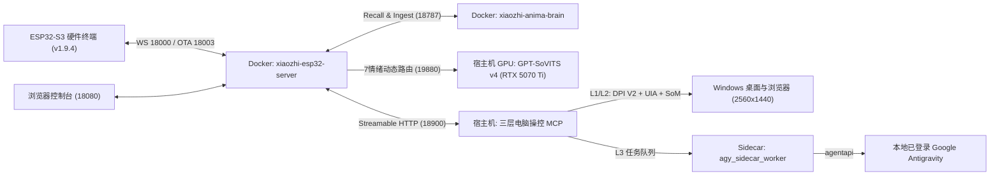

# 小智 ESP32-S3 · 雷电芽衣语音助手与三层电脑操控系统 · 项目交接与运维手册

> [!IMPORTANT]
> **项目根目录**：`e:\故事\1\xiaozhi-server`
> **开源代码仓库**：https://github.com/zou172866/xiaozhi-windows-pc-mcp
> **AI 接手必读红线**：新会话或新 Agent 接手修改本目录前，系统会自动加载 [AGENTS.md](file:///e:/故事/1/xiaozhi-server/AGENTS.md) 与全局技能 [SKILL.md](file:///C:/Users/Administrator/.gemini/config/skills/windows-pc-mcp-automation/SKILL.md)。

---

## 一、系统全景架构与端口矩阵



### 全链路端口分配表（全部采用 `>15000` 高位端口，彻底避开 Windows Hyper-V 动态保留端口冲突）

| 宿主机端口 | 归属进程 / 容器 | 作用说明 | 访问或健康检查方式 |
| :--- | :--- | :--- | :--- |
| **`18000`** | Docker `xiaozhi-esp32-server` | ESP32 实时语音双向 WebSocket 通道（容器内 `8000`） | `ws://192.168.31.200:18000/xiaozhi/v1/` |
| **`18003`** | Docker `xiaozhi-esp32-server` | ESP32 开机 OTA 握手下发配置接口（容器内 `8003`） | `http://192.168.31.200:18003/xiaozhi/ota/` |
| **`18080`** | Docker `xiaozhi-esp32-server` | **主可视化控制台**（操控挡位、模型切换、7 情绪试听、实时对话） | http://localhost:18080 |
| **`18787`** | Docker `xiaozhi-anima-brain` | **Companion Studio** 长期记忆库、人物笔记与情绪状态面板 | 双击 [打开Companion Studio控制台.bat](file:///e:/故事/1/xiaozhi-server/打开Companion%20Studio控制台.bat) |
| **`18900`** | 宿主机 `pc-mcp\.venv` Python | Windows 三层电脑操控 MCP 服务端（`/mcp`） | 日志见 `data\pc_mcp_18900.log` |
| **`19880`** | 宿主机 `gpt-sovits-studio\.venv` | `RTX 5070 Ti` 雷电芽衣 V4 / 台湾小智本地语音合成 API | 日志见 `data\gsv_19880.log` |

---

## 二、硬件终端与固件交接记录（ESP32-S3）

- **固件版本**：`bread-compact-wifi v1.9.4`（串口默认 `COM5`）
- **已验证焊接引脚定义**：
  - **INMP441 数字麦克风**：`WS = GPIO 4`、`SCK = GPIO 5`、`SD = GPIO 6`
  - **MAX98357A 数字功放**：`DIN = GPIO 7`、`BCLK = GPIO 15`、`LRC = GPIO 16`
  - **SSD1306 OLED 显示屏**：`SDA = GPIO 41`、`SCL = GPIO 42`
- **NVS 分区与回退备份**：
  - 已将设备 NVS `wifi` 命名空间（偏移 `0x9000`）中的 `ota_url` 指向本机局域网 `http://192.168.31.200:18003/xiaozhi/ota/`（保留原 Wi-Fi 账号密码免重配网）。
  - **出厂原始 NVS 备份文件**：`e:\故事\1\xiaozhi-server\data\nvs_original_backup.bin`（含家庭 Wi-Fi 凭证，已被 `.gitignore` 严格排除，切勿外传）。
  - **若宿主机局域网 IP 变化**：需同步修改 [`.config.yaml`](file:///e:/故事/1/xiaozhi-server/data/.config.yaml) 第 10～11 行的 IP，并重新刷写 NVS `ota_url`。
  - **一键恢复连接官方云端小智命令**（插上 USB 至 `COM5` 后执行）：
    ```powershell
    python -m esptool --chip esp32s3 --port COM5 write_flash 0x9000 "e:\故事\1\xiaozhi-server\data\nvs_original_backup.bin"
    ```

---

## 三、日常运维快捷入口

所有 `.bat` 均采用**纯 ASCII + CRLF** 编写，底层委托给带 UTF-8 BOM 的 PowerShell 脚本执行，并在后台无黑框静默运行（不会在任务栏留下可被误关的黑色命令行窗口）：

1. **开机/日常一键启动**：双击 [启动或重启服务.bat](file:///e:/故事/1/xiaozhi-server/启动或重启服务.bat)（调用 [start_all.ps1](file:///e:/故事/1/xiaozhi-server/data/start_all.ps1)）
   - 自动按序拉起：Docker 引擎 → `18900` 电脑操控服务 → `19880` 显卡配音服务 → 双容器 → 自动执行 `GPT-SoVITS` 冷内存回收与 WSL2 缓存释放。
2. **打大型游戏/不用时彻底关停释放显存**：双击 [关闭小智服务.bat](file:///e:/故事/1/xiaozhi-server/关闭小智服务.bat)（调用 [stop_all.ps1](file:///e:/故事/1/xiaozhi-server/data/stop_all.ps1)）
   - 停止双容器并精准关闭 `18900` 与 `19880` 监听进程（不误关已打开的浏览器）。
3. **管理挡位、模型与试听 7 种情绪**：双击 [打开网页控制台.bat](file:///e:/故事/1/xiaozhi-server/打开网页控制台.bat)（打开 http://localhost:18080 ）
4. **查看长期记忆库与人物关系**：双击 [打开Companion Studio控制台.bat](file:///e:/故事/1/xiaozhi-server/打开Companion%20Studio控制台.bat)
5. **实时滚动查看识别与工具日志**：双击 [查看实时日志.bat](file:///e:/故事/1/xiaozhi-server/查看实时日志.bat)

---

## 四、核心模块实现细节与关键文件地图

### 1. 密钥安全与容器入口层
- **核心文件**：[docker-compose.yml](file:///e:/故事/1/xiaozhi-server/docker-compose.yml)、[start_with_env.py](file:///e:/故事/1/xiaozhi-server/data/start_with_env.py)、[.config.yaml](file:///e:/故事/1/xiaozhi-server/data/.config.yaml)
- **机制说明**：
  - API 密钥存放在 Windows 用户环境变量 `DEEPSEEK_API_KEY` 与 `GEMINI_API_KEY` 中，磁盘配置文件仅写 `${DEEPSEEK_API_KEY}` / `${GEMINI_API_KEY}` 占位符，由 `start_with_env.py` 在进程内存中动态展开。
  - 默认主对话大脑为 `DeepSeekLLM`（`deepseek-flash`，即 DeepSeek V4.1 Flash，禁用长思考以保证秒级响应），`18080` 控制台保留一键切换至 `GeminiOpenAI`（`gemini-3.5-flash-lite`）入口。
  - **防抢话 VAD**：`SileroVAD` 断句静默阈值设为 `min_silence_duration_ms: 1100`、`threshold_low: 0.2`，说长句中途换气思考不会被提前截断。

### 2. 三层 Windows 电脑操控系统
- **核心文件**：[pc_control_mcp.py](file:///e:/故事/1/xiaozhi-server/pc-mcp/pc_control_mcp.py)、[agy_sidecar_worker.py](file:///e:/故事/1/xiaozhi-server/pc-mcp/agy_sidecar_worker.py)、[.mcp_server_settings.json](file:///e:/故事/1/xiaozhi-server/data/.mcp_server_settings.json)
- **三挡位物理安全锁**（状态保存在 `data/pc_control_mode.json`，在 `18080` 控制台实时秒切无需重启）：
  - **关闭（`off`）**：拒绝所有电脑操控调用；
  - **日常/游戏安全挡（`safe`）**：允许 L1（调音量、切歌、打开软件/网页并置顶、看屏幕答疑、查硬件温度）与 L3（反重力后台派单），**物理拦截 L2 模拟鼠标点击与键盘输入**，防止打游戏切屏误触；
  - **全权操控挡（`full`）**：放开 L2 网页与桌面精准点击、打字、滚轮与快捷键。
- **关键技术点**：
  - **窗口强制置顶**：`pc_open_app_or_web` 内置 64 位 Win32 `_force_foreground_window()`，通过 `AttachThreadInput` + `HWND_TOPMOST → HWND_NOTOPMOST` 破除后台焦点限制，语音说“打开B站”或“打开浏览器”直接弹出到最前。
  - **200% 高分屏三阶精准点击**：入口第 1 行锁死 `SetProcessDpiAwarenessContext(-4)`（对齐 `2560×1440` 1:1 物理像素）；`pc_ui_action` 内置「18 层 UIA 原生直点 → Set-of-Mark 红框数字角标 + `deepseek-flash` 原生视觉 `0~1000` 归一化框 → 小按钮 `768×512` 局部放大精修」，每次视觉定位输出绿十字准星核验图至 `data/last_som_grounding.jpg`。
  - **L3 反重力桥接**：宿主 Sidecar 配置位于 `C:\Users\Administrator\.gemini\config\sidecars\xiaozhi-agy-bridge\sidecar.json`，心跳文件 `data/agy_tasks/worker_heartbeat.json`，内置父进程存活检测与新实例自动接管。

### 3. 雷电芽衣 7 情绪动态语音系统
- **核心文件**：[mei_emotion_router.py](file:///e:/故事/1/xiaozhi-server/data/mei_emotion_router.py)、[mei_emotions.json](file:///e:/故事/1/xiaozhi-server/data/voices/raiden_mei/mei_emotions.json)、[test_mei_emotion_and_prosody.py](file:///e:/故事/1/xiaozhi-server/data/test_mei_emotion_and_prosody.py)
- **工作流**：
  - 模型权重位于 `data/voices/raiden_mei/v4/芽衣/`（`芽衣-e10.ckpt` + `芽衣_e10_s430_l32.pth`），外部 `GPT-SoVITS` 引擎位于 `e:\故事\1\gpt-sovits-studio`；
  - 7 条开源崩坏3雷电芽衣（CV：菊花花）参考音频覆盖 `calm / gentle / happy / playful / shy / serious / tender`；
  - 流式剥离隐藏标签（修复了 `direct_answer` 分块吞 `]` 边界问题），杜绝读出英文标签；取消首句短逗号碎切并采用 `cut0` 整句连贯合成；按 `AudioRateController` 真实播放进度同步刷新 ESP32 屏幕表情；
  - `18080` 控制台试听其他音色后会自动还原 `19880` 上的芽衣 V4 权重，不会串音。

### 4. 长期记忆双端同步、免 Key 天气与内存瘦身
- **长期记忆（[anima_memory_provider.py](file:///e:/故事/1/xiaozhi-server/data/anima_memory_provider.py) + [xiaozhi_anima_service.py](file:///e:/故事/1/xiaozhi-server/anima-brain/xiaozhi_anima_service.py)）**：
  - 数据库存储于 `data/anima/brain.sqlite3`；
  - 召回时自动去重 `【角色身份设定】` 段落，并在 `18080` 控制台保存配置时自动把角色名与设定同步到 `18787` 数据库，彻底防止双端人设冲突。
- **中央气象台免 Key 天气（[nmc_weather_patch.py](file:///e:/故事/1/xiaozhi-server/data/nmc_weather_patch.py)）**：
  - 替代上游已 `401` 过期的测试 Key，本地缓存全国 34 省市县站点（`data/nmc_stations_cache.json`），默认城市设为 `长沙`，国外城市自动走 `wttr.in`。
- **内存瘦身（[.wslconfig](file:///C:/Users/Administrator/.wslconfig) + [start_all.ps1](file:///e:/故事/1/xiaozhi-server/data/start_all.ps1)）**：
  - WSL2 已开启 `autoMemoryReclaim=gradual` 与 `memory=7GB` 上限；`start_all.ps1` 启动后自动调用 `EmptyWorkingSet` 回收 `GPT-SoVITS` 残留的 ~3.5GB CPU 冷页缓存。

---

## 五、常见故障速查表（Troubleshooting）

| 现象 | 排查位置 | 一键解决办法 |
| :--- | :--- | :--- |
| **小智有字幕/日志但不出声** | 检查 `19880` 端口是否在监听，查看 `data\gsv_19880.log` | 双击 [启动或重启服务.bat](file:///e:/故事/1/xiaozhi-server/启动或重启服务.bat) 自动重拉 `19880` 显卡配音进程 |
| **说“点开视频”提示被安全挡拦截** | 打开 http://localhost:18080 查看顶部挡位 | 在控制台顶部将电脑操控切至 **【全权操控挡】**（秒生效） |
| **点击位置偏了想看点到了哪** | 打开 `data\last_som_grounding.jpg` | 查看图中**绿十字准星**与红底编号框，确认目标当时是否在屏幕可见区域 |
| **语音派单给反重力提示离线** | 打开 Antigravity 设置 → Sidecars | 确认 `小智语音派单桥接 (Xiaozhi Bridge)` 处于开启状态，检查 `data\agy_tasks\worker_heartbeat.json` 时间戳 |
| **路由器换了导致电脑 IP 改变** | `ipconfig` 查看新局域网 IP | 更新 `.config.yaml` 与 `docker-compose.yml` 中的局域网 IP，并重刷 ESP32 NVS `ota_url` |
| **自动化自检回归验证** | 验证多情绪路由与 TTS/记忆健康度 | 执行 `docker exec xiaozhi-esp32-server python3 /opt/xiaozhi-esp32-server/data/test_mei_emotion_and_prosody.py`（17 项全绿即正常） |
